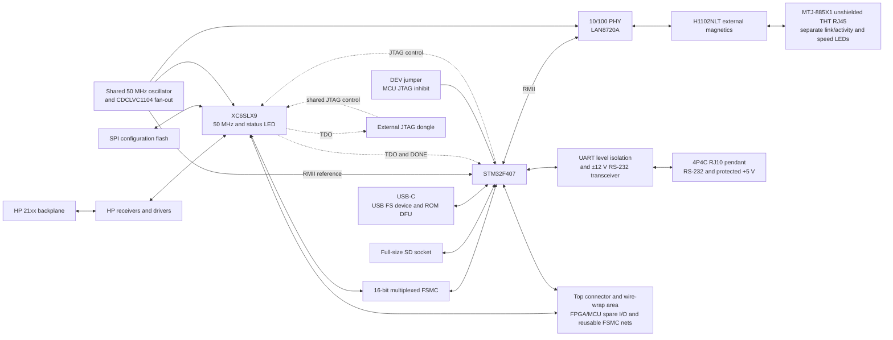

# Integrated HP 21xx I/O platform: design review

Revision **0.9 — 2026-11-08 — accepted BOM choices and rail indicators**.

This document defines the current design of the integrated HP 21xx I/O board.
The first application is HP 13210/7900 disk emulation; the platform supports
other peripheral functions through a compatible STM32 application/FPGA image
selected on SD. Review the design before schematic capture.

An [initial four-sheet KiCad capture](../hardware/integrated/HP21xx_IO.kicad_pro)
and [PDF preview](../hardware/integrated/HP21xx_IO.pdf) are now available.
[Capture notes and remaining circuit work](../hardware/integrated/README.md)
distinguish the wired first pass from the unreleased portions of this design.

Component choices, pin assignments and configuration structure below are the
current design. Remaining decisions and verification work are collected in
**section 5**. Electrical planning allowances still need validation for the
completed circuit and each supported application.

The [power calculation](INTEGRATED_BOARD_POWER.md),
[functional BOM](INTEGRATED_BOARD_BOM.csv) and its
[quantity/sourcing notes](INTEGRATED_BOARD_BOM.md),
[STM32 pin inventory](INTEGRATED_BOARD_STM32_PINS.csv) and
[FPGA pin inventory](INTEGRATED_BOARD_FPGA_PINS.csv) accompany this document.
The BOM includes selected devices, proposed support parts and explicit unresolved
items. It is a design/procurement baseline, not a schematic-derived assembly
release. Through-hole components are sourced from **TME**; surface-mount parts
use **JLCPCB/LCSC** where matched. **HRO TYPE-C-31-M-12/C165948** is
supplied and soldered by JLCPCB in SMT assembly, as explicitly selected. All installed components must
remain within the **12.8 mm** envelope.

The [HP bus workbook](HP%2021xx%20IO%20bus.xlsx) and
[STM32 workbook](STM32F407VET.xlsx) provide signal-allocation references.
The [prototype KiCad board](../IOB%20Proto%20Board/IOB%20Proto%20Board.kicad_pcb)
provides the board outline and card-edge geometry for layout.

## 1. Overview / goals / problem statement

The goal is a **generic HP 21xx I/O bus module that can implement different
types of peripheral interface** on a common hardware platform.
Selectable FPGA gateware supplies the bus behavior; an optional STM32
application supplies storage, control and user interfaces. The wire-wrap area
allows application-specific external circuitry without redesigning the board.
Support for any particular interface still depends on the available pins,
electrical/timing limits and the corresponding gateware/software.

The user shall be able to **dynamically select an application and its matching
FPGA gateware from the pendant**, using images stored on SD, and run the
selected peripheral function on the board.

The present wire-wrapped carrier-board prototype proves the initial approach
but is not a reproducible integrated platform. The new board should consolidate
the electronics, provide dependable startup/recovery and external development
access, and select compatible images from SD without rewriting unchanged code.
HP 13210/7900 disk emulation is the first application, not the hardware's scope.

### 1.1 Current decisions

| Item | Current design direction |
| --- | --- |
| Construction | One purpose-designed PCB replacing the wire-wrapped carrier-board assembly. |
| FPGA | **XC6SLX9-2TQG144C, LCSC C27408**, ISE target `xc6slx9-2-tqg144`. |
| FPGA clock and indication | Shared 50 MHz source, buffered to P56. **P143 active high: FPGA pin → LED/resistor series path → GND**. |
| Processor | **STM32F407VGT6, LCSC C12345**, LQFP100/**1 MiB** flash. |
| Storage | Full-size SD, four-bit SDIO; **PC7 card present**, **PB1 write protect**. |
| USB | **HRO TYPE-C-31-M-12/C165948**, supplied and soldered by JLCPCB, with **USBLC6-2SC6, C21713975** protection, for USB communications and factory-ROM DFU. VBUS detection required, away from PA9. |
| Pendant | **4P4C/RJ10**, exactly four conductors: +5 V, GND, RS-232 TX and RX. MCU **PA9/PA10 USART1** also supports debugging. |
| HP electrical interface | Reuse the receiver/driver circuits from [HP21xxReceiverDriver][receiver-repo], incorporating its corrected 3.3 V driver-input bias. |
| PON | Resistor/diode conditioning to FPGA PROGRAM_B, with power-aware gating and one BAT54 isolating the MCU reset button. |
| FPGA management | STM32 PC0/PE2/PC2/PC3 connect to FPGA TCK/TMS/TDI/TDO; PE3 reads DONE. A local 14-pin FPGA JTAG connector supports an external dongle. |
| DEV mode | A jumper indicates external FPGA development: the STM32 loader must perform **no FPGA JTAG activity at all**. Applications must honor the same ownership state. |
| Boot platform | Pendant supports dynamic application/gateware selection from SD. Resident STM32 SD loader validates the selected pair, avoids rewriting matching images, and supports checking/updating the FPGA image against the selected profile. |
| Recovery/debug | BOOT0 selection, STM32 reset button and **SWD-only MCU debug** on PA13/PA14. Disable MCU JTAG and SWO/parallel trace; PA15/PB3/PB4 are expansion GPIO. Factory ROM DFU installs/recovers the resident SD loader. |
| Expansion | Top connector/wire-wrap exposes spare FPGA and STM32 GPIO, PA4/PA5 general expansion pins, and FSMC nets for reuse after full MCU release. FPGA P66/P62 remain included. |
| Ethernet | STM32 **RMII** → LAN8720A → **Pulse H1102NLT/C18584 external magnetics** → **Adam Tech MTJ-885X1 unshielded THT RJ45**, sourced from TME; separate board LEDs; 10/100 Mb/s, no Gigabit requirement. TME orderability remains open. |
| Mechanical height | **5/8 inch (15.875 mm ≈ 15.9 mm) card pitch**, **1.6 mm PCB**; allow **at most 12.8 mm above the component-side PCB surface**, accounting for the adjacent card's solder-side leads. |
| Power | HP 4.85 V / 50 A and −2 V / 15 A machine supplies reported available. Separate MCU regulator fed through Schottkys from HP and USB; ±12 V available for RS-232; +28 V unused. |
| Schematic organization | Four **A3** sheets: FPGA; STM32 and its peripherals; HP connector/receivers/drivers; top connector/expansion/wire-wrap. |

## 2. High-level architecture



The FPGA implements bus timing and peripheral-specific logic; STM32 firmware
implements higher-level behavior and SD storage. Retain the existing FSMC
transport for compatibility. A selected application and FPGA design must agree
on their register protocol before the application starts servicing the HP bus.
An application that does not use STM32 transport may instead leave the complete
MCU FSMC connection in high impedance and use those FPGA pins for expansion.

The prototype host is an HP 2100S with 32K words and disk select codes **14/15
octal**. Those are the disk application's present configuration, not a
restriction on future platform applications. HP-model-dependent signals such
as RUN, BIOS/BIOI/BIOO and SFSB require explicit profile support.

**Four-sheet A3 KiCad organization**

| Sheet | Contents and circuit ownership |
| --- | --- |
| **1. FPGA** | XC6SLX9-2TQG144C, shared 50 MHz oscillator/fan-out, SPI configuration flash, active-high P143 LED, mode/HSWAPEN/SUSPEND straps, INIT_B/DONE access, FPGA JTAG connector and FPGA-side supply regulation/decoupling. FPGA ends of HP/FSMC/expansion nets are here. |
| **2. STM32** | STM32F407VGT6, independent 8 MHz crystal, USB-C/protection, full-size SD with PC7 CD and PB1 WP, RS-232/4P4C, Ethernet PHY/RJ45-magnetics and reference-clock receiver, MCU LED, SWD/BOOT0/DEV/reset, Schottky-OR MCU regulator and power sensing. MCU JTAG/FSMC ends and reset isolation/gating are here. |
| **3. HP interface** | HP edge connector, all 43 receivers and 24 drivers, their bias/termination networks, HP rail entry and the raw-PON conditioning network. |
| **4. Expansion** | Top connector, uncommitted FPGA pins including P66/P62, uncommitted STM32 GPIO including PA4/PA5, spare RS-232 channels, reusable FSMC nets, optional link/driver provisions, and small wire-wrap area with labelled supply/ground access. |

Keep SD, USB, RS-232 and their support on the STM32 sheet, as requested;
do not split them into separate functional sheets. Power/reset circuitry is
owned by its relevant sheet rather than creating another power page. A simple
way to keep **four drawing sheets total** is to make the FPGA drawing the root
and the other three child sheets. **All four schematic sheets shall use A3
size**; arrange the circuits within those sheets during schematic capture.
Use explicit hierarchical interfaces for shared buses and reset signals, and
consistent supply names. A signal exposed on the expansion drawing is the
same net as at the FPGA, not a second pin allocation. Physical wire-wrap area
and connector placement must be reserved in the PCB outline too.

## 3. Hardware

The following sections group the reviewed hardware by interface and device.
Open implementation details and verification work are listed in section 5.

### 3.1 Interfaces

Each row describes an **external entity and its connection to the module**.
The MCU-to-FPGA JTAG, FSMC and DONE links belong in the device sections.

| External entity | Module connection | Purpose / detailed section |
| --- | --- | --- |
| HP 21xx computer | 86-contact HP card edge; bus receivers/drivers and supply entry | Peripheral interface to the computer; 3.2.5 and Appendix A |
| Ethernet LAN | RJ45 10/100BASE-TX, transformer isolated; no PoE | Network access for supported applications; 3.3.8 |
| USB host computer | USB-C, USB 2.0 full-speed device and VBUS input | Communications and MCU recovery power/DFU; 3.3.1/3.3.3 |
| Removable full-size SD card | SD socket with mechanical present/write-protect switches | Platform profiles, images and application data; 3.3.4 |
| External control/debug pendant | Four-conductor 4P4C/RJ10: +5 V, GND, RS-232 TX/RX | UI/buttons and serial debugging; 3.3.5 |
| Experimental circuitry / external peripheral | Top connector and wire-wrap posts for available FPGA/MCU signals, labelled supply/ground | Application-specific extension; 3.2.4/3.2.6/3.3.9 |
| External service/programming tools | Local 14-pin 2.54 mm FPGA connector and right-angle 20-pin 2.54 mm ST-LINK/SWD header | External maintenance access; 3.2.3.2 and 3.4 |

HP machine capacity is reported as **4.85 V / 50 A** and **−2 V / 15 A**.
The board may also use ±12 V for RS-232 and future analog conditioning;
+28 V is unused. Per-slot contact/copper current and pendant allowance remain
to be checked. USB host operation/USB PD and Ethernet PoE are not requested.

### 3.2 FPGA

Selected **Xilinx XC6SLX9-2TQG144C, LCSC C27408**, commercial grade,
TQG144, speed −2; use ISE target `xc6slx9-2-tqg144` and the pin inventory below. Preserve **P143 active-high LED**: FPGA pin →
LED/resistor series path → GND. The accepted LED is **KT-0603R/C2286**,
with **470 Ω/C23179**; verify current and brightness; the disk gateware currently uses activity pulses and heartbeat.

The [configuration guide][ug380], [electrical data sheet][ds162] and installed
`xc6slx9_tqg144.bsd` package file are the pin/supply references.

#### 3.2.1 Power / regulators

| Supply / load | Voltage | Current requirement / allowance | Regulation |
| --- | --- | --- | --- |
| FPGA VCCINT | **1.2 V** nominal | **1,000 mA provisional allocation**, actual design/startup demand to be estimated | Independent **2 A buck** from HP 4.85 V |
| FPGA VCCAUX and VCCO | **3.3 V** selected | **200 mA provisional FPGA allocation**, excluding the external pull-ups below | Shared `+3V3_HP` rail, independent **2 A buck** from HP 4.85 V |
| Receiver collector pull-ups | 3.3 V | **645 mA** maximum resistor calculation: `43 × 3.3 / 220 Ω` | Included in `+3V3_HP` |
| Driver-input pull-ups | 3.3 V | **39.6 mA**: `24 × 3.3 / 2 kΩ` | Included in `+3V3_HP` |
| Flash, LED, PON, other bias/reserve | 3.3 V | Approximately **79 mA** allocation | Included in `+3V3_HP` |
| Shared 50 MHz oscillator and fan-out | 3.3 V | **50 mA** planning allowance | Included in `+3V3_HP` |
| FPGA/interface subtotal before Ethernet | 3.3 V | **1,013 mA** planning load | Shared `+3V3_HP` |
| Ethernet PHY, magnetics drive and LEDs | 3.3 V | **200 mA planning allowance**, including 10 Mb/s fallback case | Same HP-side rail |
| **Total shared HP-side 3.3 V rail** | **3.3 V** | **1,213 mA ≈ 1.21 A** | **2 A buck** |

Use **TI TLV62569DBVR, C141836, SOT-23-5** for both stages: 2.5–5.5 V
input, adjustable output, 2 A rating. Set one to 1.2 V and one to 3.3 V.
These are engineering current allocations, not measured FPGA consumption or
guaranteed worst-case chip currents. Use Xilinx Power Estimator for the actual
gateware, clocks, temperature and I/O loads, then verify startup and operation.
Connect every VCCINT/VCCAUX/VCCO pin and provide local bypassing. [FPGA supply
requirements][ds162], [regulator data sheet][buck].

The pull-ups make a material load: a 3.3 V LDO would dissipate about **1.88 W**
at the revised 1.213 A shared rail load; a buck at an assumed 90% efficiency
loses about **0.44 W**. The 1.2 V/1 A stage would lose 3.65 W as an LDO from 4.85 V.
Use switching regulators; check their inductors, effective capacitance, copper
and thermal behavior. The five-pin DBVR has no power-good output.

Detailed resistor currents, feedback values, inductor calculations, −2 V
termination load and direct +5 V driver consumption are in the
[power calculation](INTEGRATED_BOARD_POWER.md). Estimated board 4.85 V input
subtotal is approximately **2.13 A including Ethernet**, before HP output collector currents and
pendant load. It is not a complete worst-case bound. Power/reset sequencing
must account for the flash readiness delay and independent MCU power domain.

Use the same selected support circuit for all three TLV62569 stages:
**Bourns SRP5030T-2R2M / C1329375**, 2.2 µH; **4.7 µF X7R input**;
**100 nF input bypass**; **22 µF X5R output**; 1% feedback resistors and an
EN-to-VIN 0 Ω link. The detailed part numbers, per-rail dividers, quantities,
inductor-current checks and layout rules are in
[power section 3.1](INTEGRATED_BOARD_POWER.md#31-selected-buck-support-components).

#### 3.2.2 Clock generator

Use **one free-running 50 MHz source**, **YXC OT2EL4C4JI-111OLP-50M,
C5203552**, 3.3 V CMOS, SMD3225, feeding a **TI CDCLVC1104PWR, C485518**
1:4 clock fan-out buffer on `+3V3_HP`. Fit 100 nF locally at each IC and a
4.7 µF buffer supply bypass. Pull oscillator OE high with 10 kΩ; tie the
buffer's 1G enable high. No MCU firmware or FPGA configuration is needed to
start this clock.

| CDCLVC1104 connection | Destination |
| --- | --- |
| CLKIN pin 1 | Oscillator output pin 3 |
| Y0 pin 3 | FPGA P56 application clock |
| Y1 pin 8 | LAN8720A XTAL1/CLKIN |
| Y2 pin 5 | STM32 PA1 RMII REF_CLK |
| Y3 pin 7 | Leave unconnected |
| 1G pin 2 / VDD pin 6 / GND pin 4 | High / `+3V3_HP` / GND |

Use separate point-to-point clock branches, with source-series footprints
(start with 10 Ω at buffer outputs; finalize with routing/load analysis).
Match PHY/MAC clock routing and check RMII timing, oscillator total ±50 ppm
budget, duty cycle and the PHY's 150 ps peak-to-peak jitter requirement.
The oscillator drives only the buffer input; check that load against its
15 pF rating. The fan-out's low output skew avoids directly combining all
three receiver loads on the oscillator. [Clock buffer][clock-buffer],
[oscillator drawing][ethernet-clock-ds].

The FPGA and Ethernet require 50 MHz clock signals but do not require two
oscillators. The shared clock remains independent of FPGA gateware. FPGA
**CCLK/P70** is a separate configuration clock. STM32 retains its **8 MHz
crystal** for CPU/USB clocks and USB-only operation; it does not depend on
the HP-powered 50 MHz source to boot.

#### 3.2.3 FPGA configuration

**Configuration status, straps and probe access**

Provide accessible INIT_B and DONE probe pads with nearby GND. A suitable
header pad can provide the same access. These signals help diagnose reset,
configuration errors and completion, including passive checks in DEV mode.

| Signal | Purpose and connection |
| --- | --- |
| **INIT_B, P39** | Active-low, open-drain initialization/configuration status. Pull up to `+3V3_HP` and provide probe access. Reserve its status function; no MCU GPIO connection. |
| **DONE, P71** | Configuration-completion indication to **STM32 PE3**, with FPGA-side pull-up and probe access. It does not establish design identity or application readiness. |
| **HSWAPEN, P144** | **Tie to GND** to enable weak user-I/O pull-ups during pre-configuration initialization and programming. Reserve the pin; never drive it from user logic. |
| **SUSPEND, P73** | **Tie directly to GND**; suspend mode is unused. Reserve the pin. |

**Behavior before configuration and during reset**

| FPGA state | User-I/O behavior |
| --- | --- |
| Supplies absent or ramping below operating thresholds | Do not rely on internal bias; external circuits must tolerate the power sequence. |
| Configuration reset / PROGRAM_B low, with valid rails | User output drivers are disabled; HSWAPEN low enables weak pull-ups during initialization. |
| Bitstream loading | Unused user I/O remains weakly pulled high; active configuration pins perform their configuration functions. |
| Startup complete | The bitstream controls output enables and pull settings; HSWAPEN does not impose a permanent pull-up policy. |
| STM32-only reset button | FPGA configuration and its configured I/O behavior continue. |

HSWAPEN low supplies useful default highs, but its weak pulls do not replace
the **220 Ω receiver pull-ups**, **2 kΩ HP driver-input pull-ups**, or defined
post-configuration FSMC/flash bias. Keep external bias where electrical loading
or inactive-state requirements need it. [UG380, table 5-2 and initialization][ug380].

Set **M1/P60 low and M0/P69 high** for Master SPI (`01`). Keep an external
flash-CS pull-up and define unused-pin behavior in every bitstream, including
the programming bridge. Startup pull-ups must be included when checking
expansion loads and MCU/FPGA power-domain isolation.

##### 3.2.3.1 SPI NOR flash

Use **GD25Q16ESIG, C2693492**, **2.7–3.6 V, 16 Mbit / 2 MiB**, for x1 SPI
configuration, in the **208 mil SOP-8** footprint. Validate power-on boot and
the programming path with this exact device.

Its JEDEC ID is **C8 40 15** and QE defaults low. The programming tool needs explicit
GigaDevice identification/status-register handling and must preserve the
required /WP and /HOLD behavior. Implement and test this support before use.
[GigaDevice data sheet][gd-flash].

| Function | FPGA package pin | Flash pin / connection |
| --- | --- | --- |
| CSO_B / flash select | P38 | 1, /CS |
| CCLK / SPI clock | P70 | 6, CLK |
| DIN / flash-to-FPGA data | P65 | 2, DO/IO1 |
| MOSI / FPGA-to-flash data | P64 | 5, DI/IO0 |
| Master SPI strap M1 | P60 | Pull low |
| Master SPI strap M0 | P69 | Pull high |
| Configuration reset PROGRAM_B | P37 | Conditioned PON reset, 3.2.7 |
| Configuration done DONE | P71 | STM32 PE3 input; probe access |

Initial configuration remains **SPI x1**, starting at flash address zero.
The existing implementation uses CCLK startup and a 2 MHz initial configuration
clock. Keep /CS inactive while its driver is released. For the new board,
provide defined inactive levels for flash /WP/IO2 and /HOLD/IO3. Any future quad
wiring needs its own pin review. See the [existing flash workflow](../toolchain/FLASH.md).
Fit resistor pull-ups on /CS, /WP and /HOLD; check the GD power-up timing
before releasing configuration reset.

##### 3.2.3.2 JTAG to STM32 and local 14-pin connector

| Signal | STM32 GPIO | STM32 LQFP100 pad | FPGA TQG144 pad | MCU idle / DEV | MCU programming |
| --- | --- | --- | --- | --- | --- |
| TCK | PC0 | 15 | P109 | Input, no pulls | Output |
| TMS | **PE2** | **1** | P107 | Input, no pulls | Output |
| TDI | PC2 | 17 | P110 | Input, no pulls | Output |
| TDO | PC3 | 18 | P106 | Input, no pulls | Input |
| DONE | **PE3** | **2** | P71 | Input, no pulls | Input |

The STM32 uses GPIO to control FPGA JTAG; this is independent of its own
SWD debug port. Keep MCU JTAG, SWO and parallel trace disabled. PA13/PA14
remain dedicated to SWD; PA15/PB3/PB4 are expansion GPIO.

Connect a local **14-pin FPGA JTAG connector**, as requested, in parallel with
the MCU branches. Use the standard keyed **2 × 7, **2.54 mm** Platform
Cable** interface, with these electrical assignments:

| Header pin(s) | Connection |
| --- | --- |
| 1, 3, 5, 7, 9, 11 | GND |
| 2 | `+3V3_HP` target VREF; not an input power source for the board |
| 4 | TMS, FPGA P107 |
| 6 | TCK, FPGA P109 |
| 8 | TDO, FPGA P106 |
| 10 | TDI, FPGA P110 |
| 12 | NC |
| 13 | Cable PGND/pseudo-ground function; leave NC |
| 14 | Cable HALT function in JTAG mode; leave NC |

Check the user's dongle orientation, pin-1 marking and footprint numbering
against the actual 2.54 mm cable. These signal assignments follow
[DS593 figure 14][jtag-cable]; the accepted header is TME **CONNFLY DS1013-14SSIBG / ZL231-14PG**;
verify its drawing, height and mated-cable clearance before capture.
Do not wire INIT_B/PROGRAM_B to the cable's alternate serial/SPI-mode positions.

**100–220 Ω series footprints** go in the three MCU output branches,
not in a way that isolates the dongle from the FPGA. Bias the FPGA-side JTAG
nets deliberately; MCU idle settings remain input/no pull. Series resistors
do not replace programmer ownership: fit DEV before external programming.

DONE's external pull-up belongs on `+3V3_HP`; PE3 must not backfeed the FPGA
from the MCU rail. Claim JTAG only with HP power present and DEV absent.
The DEV contract is specified in **3.3.6**. JPROGRAM supports FPGA reload
without pulsing the shared physical PROGRAM_B/MCU reset path.

#### 3.2.4 FSMC interface to STM32 and wire-wrap area

| FSMC signal | STM32 GPIOs, low bit first | FPGA pads, low bit first |
| --- | --- | --- |
| AD0-AD3 | PD14, PD15, PD0, PD1 | P100, P99, P98, P97 |
| AD4-AD12 | PE7, PE8, PE9, PE10, PE11, PE12, PE13, PE14, PE15 | P95, P94, P93, P92, P88, P87, P85, P84, P83 |
| AD13-AD15 | PD8, PD9, PD10 | P82, P81, P80 |
| NOE | PD4 | P79 |
| NWE | PD5 | P78 |
| NADV / FSMC_NL | PB7 | P75 |
| AUX2, fitted; application-defined | PB9 | P74 |
| AUX1, fitted; application-defined | PB8 | P67 |

These are 19 active transport wires plus **two fitted bidirectional auxiliary
nets, AUX1 and AUX2**. Their function is application-defined; neither is
assigned to IRQ or DRQ. Keep both MCU/FPGA ends as inputs until assigned.
No physical NE signal is used by the current single-FSMC-device implementation.
Keep control strobes externally inactive during reset; release the AD bus
outside FPGA read windows. Preserve the documented register protocol initially.
[FSMC implementation and timing](../firmware/stm32/README.md)

**Agreed FSMC release and FPGA-only applications**

Route access to **all 19 FSMC nets**, plus fitted AUX1/P67 and AUX2/P74, to
the expansion area. They remain connected to the STM32; reuse requires its
pins to be in high impedance, not merely an idle FSMC bus. For an application
that does not use the STM32 backend, the loader and application must:

1. Select the released-bus policy **before** configuring an FPGA design that
   drives those nets. Do not briefly initialize FSMC first.
2. Stop transport accesses, DMA and interrupts, then disable FSMC operation.
   Disabling its clock alone is insufficient.
3. Return **every connected MCU pin**—AD0–AD15, NOE, NWE and NADV, plus
   PB8/PB9 auxiliary connections—to GPIO input with **no pull-up/down**, or an
   equivalent documented high-impedance mode. Release the strobes too.
4. Preserve that state through handoff, errors and resets. Before re-enabling
   transport, first load/verify an FPGA design that releases conflicting
   expansion outputs. Do not access the FSMC memory window in expansion mode.

Fixed external bias remains a load when GPIOs are released. Use weak
FPGA-side control pull-ups and omit unnecessary AD pull-ups, with configurable/
DNP footprints where reuse needs flexibility. Provide disconnect-link
footprints at the MCU branches if practical; expansion posts belong on the
**FPGA side** of those links.

A high-impedance MCU is still electrically connected: expansion signals must
stay within both devices' pin ratings, including powered-off conditions.
These are **3.3 V logic nets**; external drivers/receivers handle other levels.
If the MCU is omitted or can be unpowered while expansion drives these nets,
open the links or provide isolation. [GPIO/FSMC reference][stm32-rm].

#### 3.2.5 HP 21xx I/O pins connected to the FPGA

Use [HP21xxReceiverDriver][receiver-repo] as the circuit reference. The upstream
revision inspected for this review is
[`fc92e9d4aa22cc9dab332444d343fde6f802ec13`][receiver-revision]
(retrieved 2026-10-31). Its schematic SHA-256 is
`aa0e1389faad65e0f919ea2b79baefb2bf7e7c6236e3b779a07f916a1f034ae4`.

The exported netlist confirms **R49–R54 are 2 kΩ pull-ups to `PLUS3_3V_IN`**,
supplied on driver-module J1 pin 1. The [upstream README][receiver-readme]
notes that the updated circuit still needs hardware validation.

Integrate the functions into the new board, adapting module power distribution
to the central supplies. Repeated regulator/connector blocks need not be copied
literally. Retain the actual electrical topology unless a change is reviewed:
74ACT04-driven transistor emitter outputs and transistor receivers, with the
source's MMBT2369A/diode/resistor networks.

Both receiver and driver invert voltage. A high FPGA driver-input level is the
inactive HP output condition. Provide external **3.3 V** driver-input bias so
outputs remain inactive before configuration and during JTAG bridge loading.
Use **2 kΩ** for these driver-input pull-ups and verify loading and inactive
levels in the completed circuit.
The [power review](INTEGRATED_BOARD_POWER.md#4-direct-hp-loads-and-total-input-estimate)
also identifies about **0.49 A direct +5 V driver base-bias current** with all
24 drivers inactive. Those 220 Ω resistors can dissipate about 90 mW each;
select appropriate packages/derating rather than copying every 0402 footprint.

HP backplane signals are emitter-follower driven with pulls toward -2 V;
neither the inactive low nor the active high is an ordinary push-pull 3.3 V
logic output. Account for receiver current, termination and propagation delay.
[HP interfacing guide, sections 5-8/5-9][hp-io]

Provide **43 receiver channels and 24 driver channels**, including separate
RUN receive/drive paths. Appendix A and the pin table give the allocation.

The initial timing reference remains the user-reported 200 ns shortest HP
pulse, ten cycles at 50 MHz. Validate actual thresholds, load, propagation and
setup/hold on hardware. No generalized HP-model timing guarantee is claimed.

#### 3.2.6 Uncommitted pins and wire-wrap area

**Agreed:** provide a small plated-through-hole prototyping area accepting
proper wire-wrap posts, with a top connector and labelled access to uncommitted
FPGA I/O, including **P59, P61, P62 and P66**. These are general-purpose
expansion nets. Route the reusable FSMC pins above to the same area.

Expose ground and labelled logic supplies with room for small drivers and
receivers. Match the supplied prototype wire-wrap geometry: **2.54 mm nominal
grid, 1.6 mm circular copper pads and 0.8 mm plated drills** on both copper
layers. These values were read from the prototype's 5,379 isolated single-pad
footprints. Confirm finished-hole fabrication tolerance against the actual
wire-wrap posts; keep the specified nominal pad/drill geometry.

| Group | FPGA pins / access | Use |
| --- | --- | --- |
| Uncommitted GPIO | **P59, P61, P62, P66** | General experimentation |
| Fitted auxiliary interconnect | **P67 ↔ PB8 AUX1; P74 ↔ PB9 AUX2** | Application-defined function/direction; access requires both devices released |
| Active FSMC | **19 pins in 3.2.4** | Reusable under the complete transport-release policy |

Route access to **25 FPGA signal nets**, including reusable transport and
AUX1/AUX2, plus supply/ground and the spare RS-232 channel nodes in 3.3.5.
Route the **25 uncommitted/conditional STM32 pins** listed in 3.3.9, including
PA4/PA5. AUX1/AUX2 are shared MCU/FPGA nets; their two ends are not independent
expansion signals. Keep expansion stubs short and check FSMC loading.

**Informative analog capability:** PA4 and PA5 are ordinary uncommitted
expansion pins that also support the STM32's two native **12-bit DACs**.
They can be used for analog or digital experiments, including an X/Y scope
example. The board does not dedicate them to a DAC application or require
X/Y buffers/connectors. Observe ST's voltage/load limits and add external
conditioning in the expansion area as the experiment requires.
[STM32 DAC/pin characteristics][stm32-ds].

Area dimensions, numbered external/top-connector allocation and post part
remain layout choices. The spare RS-232 line side reaches this external I/O
connector; keep it distinct from 3.3 V GPIO posts and HP backplane signals.

#### 3.2.7 Reset

Condition HP PON to 3.3 V with the resistor/diode network in
[IMG_7708.JPG](IMG_7708.JPG). Connect it to FPGA PROGRAM_B and to the
power-aware, diode-isolated MCU reset branch. Do not connect raw negative PON
to either device's reset pin.

| Element | Connection |
| --- | --- |
| R_PON | 470 Ω between `HP_PON_RAW` and `PON_SER` |
| D_PON, 1N4148 | Anode `PON_RESET_N`, cathode `PON_SER` |
| R_RESET | 1 kΩ from `+3V3_HP` to `PON_RESET_N` |
| R_BIAS | 470 Ω from `+3V3_HP` to `RESET_CLAMP_REF` |
| D_REF, 1N4148 | Anode `RESET_CLAMP_REF`, cathode GND |
| D_CLAMP, 1N4148 | Anode `RESET_CLAMP_REF`, cathode `PON_RESET_N` |
| FPGA PROGRAM_B | P37 directly to `PON_RESET_N` |
| MCU reset gate | **TI SN74LVC1G32DBVR**, `MCU_PON_RELEASE = PON_RESET_N OR HP_ABSENT`, powered by `+3V3_MCU`; 100 nF local bypass |
| D_MCU, BAT54 | **Anode `MCU_NRST`, cathode `MCU_PON_RELEASE`** |
| STM32 reset button | `MCU_NRST` to GND when pressed |
| MCU local bias | 10 kΩ to `+3V3_MCU`, 100 nF to GND at `MCU_NRST` |

```text
PON_RESET_N -------------------------> FPGA PROGRAM_B (P37)
       |     HP_ABSENT
       |        |
       +------ OR gate ---- cathode [BAT54] anode ---- MCU_NRST
                  +3V3_MCU                              |      |
                                                    button   local bias
                                                       |
                                                      GND
```

| Event | Required electrical behavior |
| --- | --- |
| HP PON reset with HP power present | Reset MCU and clear FPGA configuration. |
| MCU reset button / SWD / MCU-generated NRST | Reset MCU without pulling FPGA PROGRAM_B low. |
| JTAG JPROGRAM | Clear/reconfigure FPGA internally without asserting physical PROGRAM_B. |
| HP power absent, MCU USB-powered | HP reset branch releases MCU; FPGA/HP circuitry stays unpowered. |

Use the PA0 HP-presence detector as a hardware gate input, independent of
firmware. The gate supports partial-power operation;
verify total reset-low voltage, including diode drop, and release timing.
The circuit has shown repeated successful prototype starts, but voltage and
startup margins need measurement. The −2 V rail alone does not establish the
loaded PON level because the conditioner supplies current into the bus pull.
See 3.3.7 and open issue H04.

#### 3.2.8 Complete FPGA package-pin inventory

This table accounts for **all 144 TQG144 pins**, using the installed Xilinx
`xc6slx9_tqg144.bsd`, the workbooks and the current controller pin-map reader.
The HP and 19-wire transport assignments are listed explicitly below.
TMS connects to STM32 PE2; DONE connects to STM32 PE3.
**Usage** groups pins by their board function. Direction is relative to the FPGA.
`Conditional` means a connected MCU or
other fixed function must first be released/disconnected. Supply/configuration
pins are accounted for explicitly and are not spare GPIO.

Machine-readable allocation and detailed notes:
[FPGA pin inventory](INTEGRATED_BOARD_FPGA_PINS.csv).

| Pad | Pin | Usage | Function / connection | Direction | Expansion |
| --- | --- | --- | --- | --- | --- |
| 1 | IO_P1 | HP-BUS | HP IOB2 TX; HP contact 41 | O | No |
| 2 | IO_P2 | HP-BUS | HP IOB1 TX; HP contact 38 | O | No |
| 3 | GND | POWER | GND | Power | No |
| 4 | VCCO_3 | POWER | +3V3_HP | Power | No |
| 5 | IO_P5 | HP-BUS | HP SCM_H; HP contact 37 | I | No |
| 6 | IO_P6 | HP-BUS | HP IOB0 TX; HP contact 35 | O | No |
| 7 | IO_P7 | HP-BUS | HP SCL_H; HP contact 34 | I | No |
| 8 | IO_P8 | HP-BUS | HP IRQH; HP contact 33 | O | No |
| 9 | IO_P9 | HP-BUS | HP SIR; HP contact 32 | I | No |
| 10 | IO_P10 | HP-BUS | HP IOB10 RX; HP contact 31 | I | No |
| 11 | IO_P11 | HP-BUS | HP IOB2 RX; HP contact 30 | I | No |
| 12 | IO_P12 | HP-BUS | HP IOB1 RX; HP contact 29 | I | No |
| 13 | GND | POWER | GND | Power | No |
| 14 | IO_P14 | HP-BUS | HP IOB9 RX; HP contact 28 | I | No |
| 15 | IO_P15 | HP-BUS | HP IOB8 RX; HP contact 27 | I | No |
| 16 | IO_P16 | HP-BUS | HP IOB0 RX; HP contact 26 | I | No |
| 17 | IO_P17 | HP-BUS | HP SFS; HP contact 25 | I | No |
| 18 | VCCO_3 | POWER | +3V3_HP | Power | No |
| 19 | VCCINT | POWER | +1V2_FPGA | Power | No |
| 20 | VCCAUX | POWER | +3V3_HP | Power | No |
| 21 | IO_P21 | HP-BUS | HP IOI; HP contact 24 | I | No |
| 22 | IO_P22 | HP-BUS | HP PRH; HP contact 23 | I | No |
| 23 | IO_P23 | HP-BUS | HP STC; HP contact 22 | I | No |
| 24 | IO_P24 | HP-BUS | HP CLC; HP contact 21 | I | No |
| 25 | GND | POWER | GND | Power | No |
| 26 | IO_P26 | HP-BUS | HP IOO; HP contact 20 | I | No |
| 27 | IO_P27 | HP-BUS | HP SRQ; HP contact 19 | O | No |
| 28 | VCCINT | POWER | +1V2_FPGA | Power | No |
| 29 | IO_P29 | HP-BUS | HP IOB16_OR_BIOS_N; HP contact 18 | I | No |
| 30 | IO_P30 | HP-BUS | HP POPIO; HP contact 17 | I | No |
| 31 | VCCO_3 | POWER | +3V3_HP | Power | No |
| 32 | IO_P32 | HP-BUS | HP SCL_L; HP contact 16 | I | No |
| 33 | IO_P33 | HP-BUS | HP IOG; HP contact 15 | I | No |
| 34 | IO_P34 | HP-BUS | HP SCM_L; HP contact 14 | I | No |
| 35 | IO_P35 | HP-BUS | HP CRS; HP contact 13 | I | No |
| 36 | VCCAUX | POWER | +3V3_HP | Power | No |
| 37 | PROGRAM_B | CONFIGURATION | Conditioned PON reset | I | No |
| 38 | CSO_B | CONFIGURATION | Flash /CS pin1 | O | No |
| 39 | INIT_B | CONFIGURATION | Configuration status, FPGA-rail pull-up and probe access | I / open-drain O | No |
| 40 | IO_P40 | HP-BUS | HP SKF; HP contact 12 | O | No |
| 41 | IO_P41 | HP-BUS | HP T3; HP contact 11 | I | No |
| 42 | VCCO_2 | POWER | +3V3_HP | Power | No |
| 43 | IO_P43 | HP-BUS | HP IAK; HP contact 10 | I | No |
| 44 | IO_P44 | HP-BUS | HP STF; HP contact 9 | I | No |
| 45 | IO_P45 | HP-BUS | HP IEN; HP contact 8 | I | No |
| 46 | IO_P46 | HP-BUS | HP CLF; HP contact 7 | I | No |
| 47 | IO_P47 | HP-BUS | HP IRQL; HP contact 6 | O | No |
| 48 | IO_P48 | HP-BUS | HP SFC; HP contact 5 | I | No |
| 49 | GND | POWER | GND | Power | No |
| 50 | IO_P50 | HP-BUS | HP FLGL; HP contact 4 | O | No |
| 51 | IO_P51 | HP-BUS | HP PRL; HP contact 3 | O | No |
| 52 | VCCINT | POWER | +1V2_FPGA | Power | No |
| 53 | VCCAUX | POWER | +3V3_HP | Power | No |
| 54 | GND | POWER | GND | Power | No |
| 55 | IO_P55 | HP-BUS | HP IOB9 TX; HP contact 56 | O | No |
| 56 | IO_P56 | OTHER | Shared 50MHz reference from CDCLVC1104 Y0 | I | No |
| 57 | IO_P57 | HP-BUS | HP IOB4 TX; HP contact 42 | O | No |
| 58 | IO_P58 | HP-BUS | HP IOB12 TX; HP contact 57 | O | No |
| 59 | IO_P59 | UNCOMMITTED | Uncommitted GPIO | I/O | Yes |
| 60 | M1 | CONFIGURATION | Master SPI strap low | I | No |
| 61 | IO_P61 | UNCOMMITTED | Uncommitted GPIO | I/O | Yes |
| 62 | IO_P62 | UNCOMMITTED | Uncommitted GPIO | I/O | Yes |
| 63 | VCCO_2 | POWER | +3V3_HP | Power | No |
| 64 | MOSI | CONFIGURATION | Flash DI/IO0 pin5 | O | No |
| 65 | DIN | CONFIGURATION | Flash DO/IO1 pin2 | I | No |
| 66 | IO_P66 | UNCOMMITTED | Uncommitted GPIO | I/O | Yes |
| 67 | IO_P67 | FPGA-CONTROL | AUX1 ↔ STM32 PB8 | I/O | Conditional |
| 68 | GND | POWER | GND | Power | No |
| 69 | M0 | CONFIGURATION | Master SPI strap high | I | No |
| 70 | CCLK | CONFIGURATION | Flash CLK pin6 | O | No |
| 71 | DONE | CONFIGURATION | STM32 PE3; FPGA-side pull-up | I/O | No |
| 72 | CMPCS_B | CONFIGURATION | Reserved: leave NC or vendor-approved bias | Reserved | No |
| 73 | SUSPEND | CONFIGURATION | Tie GND when unused | I | No |
| 74 | IO_P74 | FPGA-CONTROL | AUX2 ↔ STM32 PB9 | I/O | Conditional |
| 75 | IO_P75 | FPGA-FSMC | FSMC_NADV ↔ STM32 PB7 | I | Conditional |
| 76 | VCCO_1 | POWER | +3V3_HP | Power | No |
| 77 | GND | POWER | GND | Power | No |
| 78 | IO_P78 | FPGA-FSMC | FSMC_NWE ↔ STM32 PD5 | I | Conditional |
| 79 | IO_P79 | FPGA-FSMC | FSMC_NOE ↔ STM32 PD4 | I | Conditional |
| 80 | IO_P80 | FPGA-FSMC | FSMC_AD15 ↔ STM32 PD10 | I/O | Conditional |
| 81 | IO_P81 | FPGA-FSMC | FSMC_AD14 ↔ STM32 PD9 | I/O | Conditional |
| 82 | IO_P82 | FPGA-FSMC | FSMC_AD13 ↔ STM32 PD8 | I/O | Conditional |
| 83 | IO_P83 | FPGA-FSMC | FSMC_AD12 ↔ STM32 PE15 | I/O | Conditional |
| 84 | IO_P84 | FPGA-FSMC | FSMC_AD11 ↔ STM32 PE14 | I/O | Conditional |
| 85 | IO_P85 | FPGA-FSMC | FSMC_AD10 ↔ STM32 PE13 | I/O | Conditional |
| 86 | VCCO_1 | POWER | +3V3_HP | Power | No |
| 87 | IO_P87 | FPGA-FSMC | FSMC_AD9 ↔ STM32 PE12 | I/O | Conditional |
| 88 | IO_P88 | FPGA-FSMC | FSMC_AD8 ↔ STM32 PE11 | I/O | Conditional |
| 89 | VCCINT | POWER | +1V2_FPGA | Power | No |
| 90 | VCCAUX | POWER | +3V3_HP | Power | No |
| 91 | GND | POWER | GND | Power | No |
| 92 | IO_P92 | FPGA-FSMC | FSMC_AD7 ↔ STM32 PE10 | I/O | Conditional |
| 93 | IO_P93 | FPGA-FSMC | FSMC_AD6 ↔ STM32 PE9 | I/O | Conditional |
| 94 | IO_P94 | FPGA-FSMC | FSMC_AD5 ↔ STM32 PE8 | I/O | Conditional |
| 95 | IO_P95 | FPGA-FSMC | FSMC_AD4 ↔ STM32 PE7 | I/O | Conditional |
| 96 | GND | POWER | GND | Power | No |
| 97 | IO_P97 | FPGA-FSMC | FSMC_AD3 ↔ STM32 PD1 | I/O | Conditional |
| 98 | IO_P98 | FPGA-FSMC | FSMC_AD2 ↔ STM32 PD0 | I/O | Conditional |
| 99 | IO_P99 | FPGA-FSMC | FSMC_AD1 ↔ STM32 PD15 | I/O | Conditional |
| 100 | IO_P100 | FPGA-FSMC | FSMC_AD0 ↔ STM32 PD14 | I/O | Conditional |
| 101 | IO_P101 | HP-BUS | HP IOB7 RX; HP contact 84 | I | No |
| 102 | IO_P102 | HP-BUS | HP IOB15 RX; HP contact 83 | I | No |
| 103 | VCCO_1 | POWER | +3V3_HP | Power | No |
| 104 | IO_P104 | HP-BUS | HP IOB14 RX; HP contact 82 | I | No |
| 105 | IO_P105 | HP-BUS | HP IOB6 RX; HP contact 81 | I | No |
| 106 | TDO | JTAG | STM32 PC3 and 14-pin header pin8 | O | No |
| 107 | TMS | JTAG | STM32 PE2; header pin4 | I | No |
| 108 | GND | POWER | GND | Power | No |
| 109 | TCK | JTAG | STM32 PC0 and header pin6 | I | No |
| 110 | TDI | JTAG | STM32 PC2 and header pin10 | I | No |
| 111 | IO_P111 | HP-BUS | HP IOB5 RX; HP contact 80 | I | No |
| 112 | IO_P112 | HP-BUS | HP IOB13 RX; HP contact 79 | I | No |
| 113 | GND | POWER | GND | Power | No |
| 114 | IO_P114 | HP-BUS | HP IOB12 RX; HP contact 78 | I | No |
| 115 | IO_P115 | HP-BUS | HP IOB4 RX; HP contact 77 | I | No |
| 116 | IO_P116 | HP-BUS | HP IOB15 TX; HP contact 74 | O | No |
| 117 | IO_P117 | HP-BUS | HP SFSB_OR_BIOI_N; HP contact 73 | I | No |
| 118 | IO_P118 | HP-BUS | HP BIOO_N; HP contact 67 | I | No |
| 119 | IO_P119 | HP-BUS | HP PON; HP contact 66 | I | No |
| 120 | IO_P120 | HP-BUS | HP IOB14 TX; HP contact 65 | O | No |
| 121 | IO_P121 | HP-BUS | HP IOB3 RX; HP contact 64 | I | No |
| 122 | VCCO_0 | POWER | +3V3_HP | Power | No |
| 123 | IO_P123 | HP-BUS | HP EDT; HP contact 62 | I | No |
| 124 | IO_P124 | HP-BUS | HP IOB13 TX; HP contact 61 | O | No |
| 125 | VCCO_0 | POWER | +3V3_HP | Power | No |
| 126 | IO_P126 | HP-BUS | HP IOB11 RX; HP contact 60 | I | No |
| 127 | IO_P127 | HP-BUS | HP IOB10 TX; HP contact 58 | O | No |
| 128 | VCCINT | POWER | +1V2_FPGA | Power | No |
| 129 | VCCAUX | POWER | +3V3_HP | Power | No |
| 130 | GND | POWER | GND | Power | No |
| 131 | IO_P131 | HP-BUS | HP IOB11 TX; HP contact 55 | O | No |
| 132 | IO_P132 | HP-BUS | HP IOB8 TX; HP contact 54 | O | No |
| 133 | IO_P133 | HP-BUS | HP IOB6 TX; HP contact 53 | O | No |
| 134 | IO_P134 | HP-BUS | HP IOB7 TX; HP contact 52 | O | No |
| 135 | VCCO_0 | POWER | +3V3_HP | Power | No |
| 136 | GND | POWER | GND | Power | No |
| 137 | IO_P137 | HP-BUS | HP IOB5 TX; HP contact 51 | O | No |
| 138 | IO_P138 | HP-BUS | HP RUN_DRIVE; HP contact 50 | O | No |
| 139 | IO_P139 | HP-BUS | HP RUN; HP contact 50 | I | No |
| 140 | IO_P140 | HP-BUS | HP FLGH; HP contact 49 | O | No |
| 141 | IO_P141 | HP-BUS | HP ENF; HP contact 46 | I | No |
| 142 | IO_P142 | HP-BUS | HP IOB3 TX; HP contact 45 | O | No |
| 143 | IO_P143 | OTHER | Active-high FPGA LED | O | No |
| 144 | HSWAPEN | CONFIGURATION | Tie GND; enable pre-configuration weak pull-ups | I | No |

### 3.3 STM32 — selected chip

Selected **STMicroelectronics STM32F407VGT6, LCSC C12345**, LQFP100,
**1 MiB flash**. The pin inventory includes Ethernet, FPGA FSMC/JTAG/DONE,
SDIO, USB, serial, SWD and board-control signals. PA9/PA10 serve USART1.
Linker/startup definitions must target this flash density and application layout.

Implement supply pins, VDDA/VREF filtering, VCAP capacitors, VBAT, boot straps
and local decoupling from the [data sheet][stm32-ds] and [hardware guide][stm32-hw].

#### 3.3.1 Power — USB-C / HP bus, Schottky OR and 3.3 V regulator

Use **two power Schottky diodes and an independent 3.3 V regulator**, as
requested. One anode connects to HP 4.85 V, the other to USB VBUS; joined
cathodes feed `MCU_VIN`. Use **MDD SS14/C2480**, SMA, 1 A / 40 V, with forward-drop/leakage/thermal
checks against the operating allowance. BAT54 is a reset-signal diode,
not the choice for these power paths.

```text
HP 4.85 V ---->|----+
USB VBUS ----->|----+---- MCU_VIN ---- buck ---- +3V3_MCU
```

Use **TLV62569DBVR/C141836**, set to 3.3 V. A 1 A regulator covers the
present allowance; using the same **2 A** part as the FPGA rails simplifies
sourcing. Keep this output separate from `+3V3_HP`.

| MCU-domain load | Planning allowance |
| --- | --- |
| STM32 operating current | **150 mA** |
| SD card operating/transient allowance | **300 mA**, verify the actual card |
| LED, bias and other support | **50 mA** |
| **Total at 3.3 V** | **500 mA** |

These are design allowances, not measured maximums; recheck the MCU
allowance with Ethernet MAC/DMA active. The PHY stays on `+3V3_HP`, so it does
not add its load to USB-only recovery. At 4.50 V after an assumed
0.35 V diode drop and 90% regulator efficiency, the input is about **407 mA**;
diode loss is about **0.14 W**. At a low 4.4 V USB input and 0.4 V diode drop,
4.0 V remains, above the regulator's input minimum. Review the full
cable/protection/diode worst case. [Detailed power calculation](INTEGRATED_BOARD_POWER.md).

USB powers the MCU/SD recovery domain only; FPGA, HP output drivers and pendant
remain HP-powered. Respect USB current permission, pre-enumeration/inrush and
suspend limits; the regulator rating is not permission to draw 2 A from USB.
The higher source supplies the diode OR, so USB can feed the MCU even while
HP power is present. SD shares this rail to allow bench SD recovery.

The diode OR prevents supply backfeed but does not isolate GPIO/reset paths.
In USB-only operation leave MCU-to-FPGA FSMC/JTAG outputs undriven, put DONE
bias on the FPGA rail, and prevent other signals from energizing that rail.
Detect HP power presence separately from USB. The PON reset branch requires
the power-aware gating in **3.3.7**.

Use **Samsung CL10A225KO8NNNC/C23630, 2.2 µF/16 V X5R, 0603**, one at
each VCAP pin. Provide 100 nF at each VDD pin and a 4.7 µF local MCU bulk
capacitor; **CC0603KRX7R9BB104/C14663** and **GRM21BR71A475KA73L/C86039**
are the selected common bypass/bulk parts. Keep VCAP outputs local to the MCU.
Implement VDDA/VREF filtering and local capacitors from the ST hardware guide.

#### 3.3.2 Clocks — 8 MHz crystal

Use an **independent 8 MHz HSE crystal** with load capacitors selected for
its specified load capacitance and PCB stray capacitance. MCU startup and ROM
USB DFU must not depend on a configured FPGA or its oscillator.

Use **168 MHz CPU / 48 MHz USB** application clocks. ROM DFU configures its own clocks. The independent
8 MHz reference meets the documented bootloader HSE range and is preferred
over higher-frequency choices for ROM clock detection. The BOM proposes **Lucki L538S080L11L/C5917268**, a passive 8 MHz crystal
with **12 pF load and 50 Ω ESR**, plus two **18 pF C0G capacitors/C1647**
as a starting point (assuming 3 pF combined stray capacitance). Validate
crystal drive level, oscillator gain margin and startup over temperature;
these support selections remain provisional. RTC crystal/battery support is
open; no RTC requirement was agreed. [ST hardware guide][stm32-hw],
[bootloader clock requirements][an2606].

#### 3.3.3 USB-C and USB protection

Use the user-selected **HRO TYPE-C-31-M-12/C165948** USB-C receptacle,
supplied and soldered by **JLCPCB SMT assembly**, with the selected
**USBLC6-2SC6/C21713975** protection array. Use the exact HRO footprint
and retention details. This restores the original HRO selection and removes
the GCT/TME proposal. The protection code is cataloged as **GOODWORK**, not
STMicroelectronics; use its own data sheet and pinout.
[Selected connector][usb-connector], [selected protection part][usb-esd].

USB remains a USB 2.0 **full-speed device** connection, with PA11 as
D- and PA12 as D+. Wire both plug orientations correctly. Use separate
nominal **5.1 kOhm Rd** terminations on CC1 and CC2 and provide connector-side
ESD protection. No USB PD or host function has been requested.
[ST USB-C guidance][usb-c]

**PA9/PA10 serve USART1. VBUS presence is sensed on PB0, LQFP100 pad 35**,
using **1.8 kΩ from USB VBUS to PB0 and 3.3 kΩ from PB0 to GND**, both 1%.
The sense point is upstream of the USB power-OR diode. **High means VBUS
present**. At 5.0 V, PB0 sees `5 × 3.3 / (1.8 + 3.3) = 3.235 V`, with
about **0.98 mA** divider current. Including resistor tolerance, the node is
approximately **2.827 V at 4.4 V VBUS** to **3.584 V at 5.5 V VBUS**.

PB0 is an **FT (5 V-tolerant) pin** in ST's pin table. Configure it as a
**digital input without internal pulls**, and leave its ADC/analog function
unused. The divider remains below the `VDD + 4 V` absolute limit even at
VDD = 0, while providing a valid input high at the 3.3 V rail. Check leakage
and connector transients in the schematic; do not treat the divider as ESD
protection. [ST pin/electrical limits][stm32-ds], [VBUS divider guidance][usb-vbus].

Use a separate active-low HP-power detector on **PA0, pad 23**, because it
also supplies a hardware `HP_ABSENT` signal for reset gating: NPN, 47 kΩ
HP-to-base, 100 kΩ base-to-GND and 10 kΩ collector pull-up to `+3V3_MCU`.

PB0 provides application attach detection; it is separate from the peripheral's
dedicated PA9 VBUS input. Configure the application USB stack appropriately
and use PB0 for connection handling. Validate factory ROM DFU on the selected
silicon revision with PA9/PA10 on USART1 and the pendant connected: the ROM's
interface-selection code is independent of application sensing software.
[ST bootloader interfaces][an2606].

The Schottky-OR input powers only the separate MCU recovery domain from USB;
it does not join VBUS to HP +5 V. Place ESD at the connector with short ground
returns and connect its reference/VBUS pin per the selected GOODWORK diagram.

#### 3.3.4 SD card

Use the four-bit SDIO transport.
**Use PC7 for card present and PB1 for write protect.**

| SD signal | STM32 GPIO / package pad |
| --- | --- |
| DAT0, DAT1, DAT2, DAT3 | PC8/65, PC9/66, PC10/78, PC11/79 |
| CLK | PC12/80 |
| CMD | PD2/83 |
| Mechanical card-present switch | **PC7/64** |
| Mechanical write-protect switch | **PB1/36** |
| Supply/return | `+3V3_MCU` / GND |

Use **XUNPU SD-106M/C266603**, full-size push-push, 2.9 mm high. Its
drawing has pad 10 CD and pad 11 WP switching to ground. Fit 10 kΩ
pull-ups to the MCU rail and debounce in software. [Holder drawing][sd-holder].

| Condition | PC7 card present | PB1 write-protect | Meaning |
| --- | --- | --- | --- |
| Absent | High | High | No card; ignore WP |
| Inserted, locked | Low | High | Treat SD as read-only |
| Inserted, unlocked | Low | Low | SD writes permitted |

Firmware must enforce the advisory write-protect tab for SD disk-image,
configuration and metadata writes. Reading firmware/bitfiles from a locked
card is permitted. Mechanical CD is distinct from SD contact 1 CD/DAT3.
Assign the footprint/shield/common switch pads from the actual holder drawing.
Provide local decoupling, bus pull-ups and proper clock routing; access,
ESD and optional switched card power remain to be finalized. Start SDIO at
4 MHz polling; validate higher speeds separately.

#### 3.3.5 Debug and pendant serial port — RS-232

Use **Molex 95501-2441**, TME symbol **MX-95501-2441**, **4P4C**
(commonly sold as RJ9/RJ10), right-angle through-hole with PCB retention and
a horizontal cable exit. Its **11.5 mm nominal height** leaves **1.3 mm nominal
headroom** below the 12.8 mm limit. Use its own footprint and verify maximum
installed height, board thickness, numbered contact pinout and latch access.
No LEDs or magnetics are present in this pendant connector.
[Selected jack][pendant-jack], [TME ordering page][pendant-jack-tme].

The earlier **TE Connectivity 1-1705949-1**, also 11.5 mm high, is superseded
for this BOM by the TME-sourced Molex part. The BOM includes a proposed
**TPS2553DBVR/C55266** high-side current-limited +5 V switch. The pendant
load/cable budget and its ILIM resistor remain open; do not infer them from
the connector's 1.5 A contact rating.

**Alternative:** **TE Connectivity 215875-1**, also right-angle through-hole
4P4C, **11.5 mm** high, for a 1.6 mm PCB; this version has no panel stops.
Review its own footprint and packaging rather than assuming interchangeability.
[Alternative jack and drawing][pendant-jack-alt]. The previous
**Würth 615004143821**, **14.5 mm** high, exceeds the corrected limit.
[Würth drawing][pendant-jack-old].

The four cable conductors are **+5 V, GND, RS-232 TX and RS-232 RX**.
Use **USART1 PA9/TX and PA10/RX**, through **TI SN75185DWR/C2671047**,
SOIC-20, powered by HP +4.85 V/+12 V/−12 V. Use the first driver/receiver
for the pendant. **SN74LVC2G125DCUR/C21404**, on `+3V3_MCU`, provides
pendant RX level conversion and controlled TX isolation; its enables default
to disabled when HP power is absent. USB-only recovery uses USB/SWD.

**All remaining SN75185 channels are fitted and exposed**:

| Channel | SN75185 logic pin | RS-232 line pin | Destination |
| --- | --- | --- | --- |
| Pendant TX, driver 1 | DA1, pin 16 | DY1, pin 5 | PA9 path to 4P4C TX |
| Pendant RX, receiver 1 | RY1, pin 19 | RA1, pin 2 | 4P4C RX to PA10 path |
| Expansion TX2 | DA2, pin 15 | DY2, pin 6 | Logic post to external/top I/O connector |
| Expansion TX3 | DA3, pin 13 | DY3, pin 8 | Logic post to external/top I/O connector |
| Expansion RX2 | RY2, pin 18 | RA2, pin 3 | External/top connector to 3.3 V logic post |
| Expansion RX3 | RY3, pin 17 | RA3, pin 4 | External/top connector to 3.3 V logic post |
| Expansion RX4 | RY4, pin 14 | RA4, pin 7 | External/top connector to 3.3 V logic post |
| Expansion RX5 | RY5, pin 12 | RA5, pin 9 | External/top connector to 3.3 V logic post |

Use **SN74LVC125APWR/C7813**, powered by `+3V3_HP`, to translate the four
spare 5 V receiver outputs to **3.3 V** before the logic posts. Bias spare
transmitter logic inputs to UART idle with 10 kΩ to `+3V3_HP`; allow users to
patch them from available MCU/FPGA GPIO. Define the buffer enables for rail
startup and release. All RS-232 line-side signals also reach labelled posts
and the **external/top HP I/O connector**, with final connector contacts to
allocate. Do not connect bipolar RS-232 levels to the HP backplane logic or
raw 3.3 V GPIO. [Transceiver][serial-ds], [receiver buffer][serial-exp-buffer].

Provide local bypassing at +5 V, +12 V and −12 V supply pins. Allow **50 mA
on each ±12 V rail** for the three loaded drivers plus static current; verify
actual loads/short-circuit dissipation and cable performance. The numbered
4P4C pinout, cable wiring, baud rate and protected pendant +5 V limit remain
in H10. The connector's contact rating does not define the pendant budget.

#### 3.3.6 BOOT0 mode and DEV mode

**BOOT0 / factory ROM recovery**

Preserve BOOT0 selection and a BOOT1/PB2 pull-down. BOOT0 high with BOOT1 low
at reset selects ST's factory system-memory loader, which supports USB DFU on
PA11/PA12. The independent 8 MHz crystal satisfies the documented clock range.
ROM DFU can install the resident SD loader at `0x08000000` even when application
flash is invalid. Boot with BOOT0 low afterwards. Retain SWD as another recovery
path. [ST bootloader documentation][an2606]

Provide a labelled BOOT0 jumper and MCU reset button. BOOT0 and DEV are
separate controls: BOOT0 selects the MCU boot source, DEV selects FPGA JTAG
ownership. Verify ROM recovery with the pendant connected and both supported
power sources.

**DEV jumper / FPGA JTAG ownership**

**Pin: PC6, STM32 pad 63**, with an external **10 kΩ pull-down** and a
jumper to `+3V3_MCU`. Fitted jumper means DEV.

- Read DEV before any possible FPGA JTAG operation.
- With DEV fitted, never drive TCK, TMS or TDI: **no chain scan, IDCODE read,
  USERCODE read, DONE-over-JTAG read, flash probe, JPROGRAM or bridge download**.
- Leave **PC0, PE2, PC2 and PC3** as inputs without MCU pull resistors throughout boot,
  application handoff, normal operation and error/recovery paths.
- Reading the separate DONE input is passive and permitted.
- Pass DEV/ownership state to the application; its JTAG code must obey it too.
- With DEV absent, automatic startup checks/updates may briefly claim JTAG;
  release the MCU outputs afterwards. External development requires DEV fitted.
- DEV inhibits automatic FPGA management, but not physical PON reset. Whether
  DEV also inhibits automatic **STM32 application replacement** is open; the
  user has only specified the FPGA/JTAG restriction so far.

#### 3.3.7 Reset

At **MCU_NRST**, fit **10 kΩ to `+3V3_MCU`**, **100 nF to GND**, the reset
button to GND, and the ST-LINK NRST connection. The BOM proposes **UNI-ROYAL 0603WAF1002T5E/C25804**
and **CC0603KRX7R9BB104/C14663** for the local resistor/capacitor. Their nominal
RC product is 1 ms; the internal NRST pull-up and thresholds affect release.
The **BAT54 anode is at MCU_NRST**; its cathode is on the conditioned PON
reset branch, via the power-aware gate in 3.2.7.

A bare diode connection to the HP-powered PON node would hold the USB-powered
MCU low when that node is unpowered; a pull-up/capacitor/button does not remove
that DC clamp. Use **SN74LVC1G32DBVR** on `+3V3_MCU`, with
`MCU_PON_RELEASE = PON_RESET_N OR HP_ABSENT`, ahead of the BAT54 cathode.
The PA0 HP-presence detector supplies HP_ABSENT in hardware before firmware
starts. FPGA PROGRAM_B remains directly on conditioned PON.

This retains PON reset with HP power present, allows standalone USB startup,
and isolates the MCU reset button from FPGA PROGRAM_B. Verify low-level
margins including gate/diode drops, power sequencing and flash-ready delay.
[OR gate and partial-power characteristics][reset-gate].

#### 3.3.8 Ethernet — 100BASE-TX and internal RMII

**External interface:** RJ45 to a 10/100 Ethernet LAN, maximum 100 Mb/s; no
Gigabit or PoE requirement. **Internal interface:** the F407 Ethernet MAC
supports **MII/RMII**, not RGMII. Select **RMII**, which uses seven clock/data/
control wires plus MDC and MDIO. [STM32 Ethernet capability][stm32-product].

**Selected Ethernet components**

| Function | Part | Source | Implementation notes |
| --- | --- | --- | --- |
| RMII PHY | **Microchip LAN8720A-CP-TR**, 24-QFN 4 × 4 mm | JLCPCB **C45223**, Standard assembly | 10/100 RMII; shared external 50 MHz clock. |
| External magnetics | **Pulse H1102NLT**, 16-pin SMT transformer/choke module | JLCPCB **C18584** | Separate 1:1 TX/RX isolation transformers and common-mode chokes; non-PoE; Pulse lists LAN8720A compatibility. Nominal height **5.969 mm**. |
| Unshielded RJ45 | **Adam Tech MTJ-885X1**, right-angle THT with PCB snap retention | **TME MTJ-885X1** | Plastic housing; **no metallic shield, magnetics or LEDs**. Nominal height approximately **11.7 mm**, leaving **1.1 mm** nominal margin. Confirm drawing tolerances and orderability before PCB release. |
| External indicators | Two board-mounted LEDs and separate current-limit resistors | JLCPCB; accepted **KT-0603R/C2286** and **470 Ω/C23179** | Link/activity and speed/status indication; wire LED polarity around PHY strap requirements. Initial red LEDs reduce distinct parts; brightness/current remain to validate. |
| RMII reference clock | Shared source and CDCLVC1104 fan-out, 3.2.2 | **C5203552 / C485518** | Separate buffered PHY/MAC clock branches. |

The **MTJ-885X1** is the selected low-cost mechanical candidate, but TME
showed no stock during sourcing research. Procurement remains open; do not
assume immediate availability. A same-function alternative needs its own
height, electrical category, retention and footprint checks. The
**MTJ-889X1** is nominally about **12.3 mm** high and has less margin; it
also showed no stock. [TME jack][ethernet-jack-tme],
[Adam Tech catalog][ethernet-jack-catalog],
[JLCPCB magnetics][ethernet-magnetics-jlc],
[Pulse product/compatibility reference][ethernet-magnetics-product],
[Pulse drawing][ethernet-magnetics-ds].

A stocked alternative is **Molex 85503-5001 / TME MX-85503-5001**:
unshielded Cat 5e, right-angle THT with PCB retention, no magnetics or LEDs,
**11.5 mm nominal** height. It is recommended for procurement but remains a
zero-quantity alternative pending user selection. Its footprint and maximum
installed height need review. Additional checked candidates and exclusions
are in the [BOM sourcing notes](INTEGRATED_BOARD_BOM.md#additional-tme-rj45-research).

The earlier **Pulse JXD1-1V17NL** fits the height limit but is **shielded**
and has integrated magnetics/LEDs, so it is superseded by the unshielded jack
plus external parts. The **JXD1-1V07NL** and **HR911105A** remain excluded
for excessive installed height. The shielded recessed Taoglas alternative
does not satisfy the new unshielded preference.

The expanded BOM separately enumerates magnetics, external LEDs, PHY bias,
terminations, filtering, decoupling, hardware reset and protection candidates.
These are initial support-circuit selections, to be reconciled against the
completed schematic rather than treated as an already validated reference design.

**RMII pin allocation**

| Signal | STM32 pin / pad | Direction at MCU |
| --- | --- | --- |
| REF_CLK, 50 MHz | **PA1/24** | Input |
| MDIO | **PA2/25** | Bidirectional |
| MDC | **PC1/16** | Output |
| CRS_DV | **PA7/32** | Input |
| RXD0 | **PC4/33** | Input |
| RXD1 | **PC5/34** | Input |
| TX_EN | **PB11/48** | Output |
| TXD0 | **PB12/51** | Output |
| TXD1 | **PB13/52** | Output |
| PHY reset, extra GPIO | **PE5/4** | Open-drain output |

Use AF11 for the nine MAC/management pins. Keep parallel trace disabled on
PE2–PE5. The LQFP100 pin map also accommodates all 19 FSMC wires, SDIO,
PC7/PB1 card switches, PA9/PA10 serial, USB and SWD.

**Clock, supply, reset and line-side implementation**

Use the PHY's **REF_CLK input mode**. Shared fan-out Y1 feeds PHY
XTAL1/CLKIN and Y2 feeds STM32 PA1; keep PHY XTAL2 unused. Clock power and
routing are defined in 3.2.2 and remain independent of gateware and MCU HSE.
[PHY data sheet][ethernet-phy-ds].

Power PHY analog/I/O supplies from **`+3V3_HP`**, with appropriate filtering,
local decoupling and internal-regulator output capacitors. Do not tie its
internal VDDCR regulator output to FPGA 1.2 V. Allocate **200 mA** on the shared
HP-side rail for PHY, magnetics drive, LED currents and margin;
the data-sheet chip-current figures exclude magnetics/LEDs, and 10 Mb/s can
consume more transmitter current. This is an engineering allowance requiring
verification, not a guaranteed PHY maximum. It raises the rail estimate to
**1.21 A including the separate shared-clock allowance**, within the 2 A stage. Recheck MCU current with MAC/DMA.

Provide hardware PHY power-on reset timing, then allow PE5 to assert reset;
meet the vendor's 25 ms supply-to-release and 100 µs reset-pulse requirements.
Set mode/address/regulator/clock straps deliberately, including **nINTSEL high
for REF_CLK input mode**, and account for LED loads
on strap pins. Fit MDIO bias and choose an MDC rate within the PHY limit.
Poll link status over MDIO initially; a PHY-interrupt connection is optional.

Use the **external H1102NLT** TX/RX centre taps and the Microchip/Pulse
reference circuits. Fit PHY-side terminations, bias/bypass capacitors and a
separate cable common-mode termination network as required; these are no
longer hidden inside a MagJack. There is **no RJ45 shield terminal**.
Review the chassis/ESD reference, cable-side protection and isolation layout
explicitly. Route short, controlled-impedance MDI pairs. The BOM proposes
**TPS3808G33DBVR/C43698**, CT connected through **100 kΩ to VDD**, for
hardware POR (300 ms typical, 180 ms minimum); PE5 can additionally assert
the open-drain nRST net. This closes the support-part proposal without
claiming electrical validation. During USB-only operation the PHY is off;
release RMII/management/reset outputs and do not backfeed its rail. Ethernet
remains on the **STM32 schematic sheet**, preserving the four-sheet plan.

#### 3.3.9 Complete STM32 package-pin inventory and spare access

The table accounts for **all 100 LQFP100 pins**, including power, ground,
VCAP, reset, boot and HSE. Pin numbering follows ST DS8626 and the KiCad
`STM32F407V_E-G_Tx` symbol; peripheral assignments follow ST's AF tables.
[ST package/peripheral reference][stm32-ds].

**Usage** groups pins by their board function. Direction is at the MCU;
FPGA-JTAG outputs become inputs in DEV. The
[CSV inventory](INTEGRATED_BOARD_STM32_PINS.csv) also records detailed notes.

With all **19 FSMC pins active** and **AUX1/AUX2 fitted**, there are
**20 available GPIOs plus five conditional GPIOs**, totaling **25 uncommitted
MCU pins**. PA4/PA5 belong to this pool and may serve analog or digital
experiments. PA15/PB3/PB4 are available because debug is **SWD only**;
configure them as GPIO early and keep JTAG/SWO/parallel trace disabled.

The pool is PA3, PA4, PA5, PA6, PA8, PA15; PB3, PB4, PB5, PB6, PB10,
PB14, PB15; PC13, PC14, PC15; PD3, PD6, PD7, PD11, PD12, PD13; PE0, PE1,
PE6. The **five conditional pins** are PC13–PC15 (drive/speed restrictions,
no LSE crystal on PC14/15) and PE0/PE1 (optional FSMC byte enables).
**PB8/PB9 are AUX1/AUX2**, excluded from this free pool. AUX and FSMC posts
remain accessible only with both connected devices released.

Route labelled expansion access and observe reset/ROM boot states and
per-pin voltage/load limits. Native DAC capability of PA4/PA5 is informative
in 3.2.6; there is no dedicated X/Y hardware requirement.

| Pad | Pin | Usage | Function / connection | Direction | Expansion |
| --- | --- | --- | --- | --- | --- |
| 1 | PE2 | FPGA-JTAG | FPGA_TMS | O | No |
| 2 | PE3 | FPGA-STATUS | FPGA_DONE | I | No |
| 3 | PE4 | LED | MCU_LED_N | O | No |
| 4 | PE5 | ETHERNET | ETH_PHY_RESET_N | O (open drain) | No |
| 5 | PE6 | UNCOMMITTED | Spare GPIO | I/O | Yes |
| 6 | VBAT | POWER | Backup supply; tie to MCU rail if no battery | Power | No |
| 7 | PC13 | UNCOMMITTED | Spare GPIO | I/O | Conditional |
| 8 | PC14 | UNCOMMITTED | Spare GPIO | I/O | Conditional |
| 9 | PC15 | UNCOMMITTED | Spare GPIO | I/O | Conditional |
| 10 | VSS | POWER | Ground | Power | No |
| 11 | VDD | POWER | +3V3_MCU; all pins connected and locally decoupled | Power | No |
| 12 | PH0 | CLOCK | HSE_OSC_IN | Analog I | No |
| 13 | PH1 | CLOCK | HSE_OSC_OUT | Analog O | No |
| 14 | NRST | RESET | MCU reset button and power-aware PON reset branch | I | No |
| 15 | PC0 | FPGA-JTAG | FPGA_TCK | O | No |
| 16 | PC1 | ETHERNET | ETH_MDC | O | No |
| 17 | PC2 | FPGA-JTAG | FPGA_TDI | O | No |
| 18 | PC3 | FPGA-JTAG | FPGA_TDO | I | No |
| 19 | VDD | POWER | +3V3_MCU; all pins connected and locally decoupled | Power | No |
| 20 | VSSA | POWER | Analog ground | Power | No |
| 21 | VREF+ | POWER | Analog reference; filtered MCU analog rail | Power | No |
| 22 | VDDA | POWER | Analog supply; filtered +3V3_MCU | Power | No |
| 23 | PA0 | POWER-SENSE | HP_POWER_PRESENT_N | I | No |
| 24 | PA1 | ETHERNET | ETH_RMII_REF_CLK | I | No |
| 25 | PA2 | ETHERNET | ETH_MDIO | I/O | No |
| 26 | PA3 | UNCOMMITTED | Spare GPIO | I/O | Yes |
| 27 | VSS | POWER | Ground | Power | No |
| 28 | VDD | POWER | +3V3_MCU; all pins connected and locally decoupled | Power | No |
| 29 | PA4 | UNCOMMITTED | Uncommitted GPIO / DAC_OUT1 | I/O / Analog O | Yes |
| 30 | PA5 | UNCOMMITTED | Uncommitted GPIO / DAC_OUT2 | I/O / Analog O | Yes |
| 31 | PA6 | UNCOMMITTED | Spare GPIO | I/O | Yes |
| 32 | PA7 | ETHERNET | ETH_RMII_CRS_DV | I | No |
| 33 | PC4 | ETHERNET | ETH_RMII_RXD0 | I | No |
| 34 | PC5 | ETHERNET | ETH_RMII_RXD1 | I | No |
| 35 | PB0 | POWER-SENSE | USB_VBUS_PRESENT | I | No |
| 36 | PB1 | SD-CARD | SD_WRITE_PROTECT | I | No |
| 37 | PB2 | BOOT/DEV | BOOT1 strap low | I | No |
| 38 | PE7 | FPGA-FSMC | FSMC_AD4 | I/O | Conditional |
| 39 | PE8 | FPGA-FSMC | FSMC_AD5 | I/O | Conditional |
| 40 | PE9 | FPGA-FSMC | FSMC_AD6 | I/O | Conditional |
| 41 | PE10 | FPGA-FSMC | FSMC_AD7 | I/O | Conditional |
| 42 | PE11 | FPGA-FSMC | FSMC_AD8 | I/O | Conditional |
| 43 | PE12 | FPGA-FSMC | FSMC_AD9 | I/O | Conditional |
| 44 | PE13 | FPGA-FSMC | FSMC_AD10 | I/O | Conditional |
| 45 | PE14 | FPGA-FSMC | FSMC_AD11 | I/O | Conditional |
| 46 | PE15 | FPGA-FSMC | FSMC_AD12 | I/O | Conditional |
| 47 | PB10 | UNCOMMITTED | Spare GPIO | I/O | Yes |
| 48 | PB11 | ETHERNET | ETH_RMII_TX_EN | O | No |
| 49 | VCAP_1 | POWER | Internal regulator output; local capacitor only | Power | No |
| 50 | VDD | POWER | +3V3_MCU; all pins connected and locally decoupled | Power | No |
| 51 | PB12 | ETHERNET | ETH_RMII_TXD0 | O | No |
| 52 | PB13 | ETHERNET | ETH_RMII_TXD1 | O | No |
| 53 | PB14 | UNCOMMITTED | Spare GPIO | I/O | Yes |
| 54 | PB15 | UNCOMMITTED | Spare GPIO | I/O | Yes |
| 55 | PD8 | FPGA-FSMC | FSMC_AD13 | I/O | Conditional |
| 56 | PD9 | FPGA-FSMC | FSMC_AD14 | I/O | Conditional |
| 57 | PD10 | FPGA-FSMC | FSMC_AD15 | I/O | Conditional |
| 58 | PD11 | UNCOMMITTED | Spare GPIO | I/O | Yes |
| 59 | PD12 | UNCOMMITTED | Spare GPIO | I/O | Yes |
| 60 | PD13 | UNCOMMITTED | Spare GPIO | I/O | Yes |
| 61 | PD14 | FPGA-FSMC | FSMC_AD0 | I/O | Conditional |
| 62 | PD15 | FPGA-FSMC | FSMC_AD1 | I/O | Conditional |
| 63 | PC6 | BOOT/DEV | DEV_MODE | I | No |
| 64 | PC7 | SD-CARD | SD_CARD_PRESENT_N | I | No |
| 65 | PC8 | SD-CARD | SDIO_DAT0 | I/O | No |
| 66 | PC9 | SD-CARD | SDIO_DAT1 | I/O | No |
| 67 | PA8 | UNCOMMITTED | Spare GPIO | I/O | Yes |
| 68 | PA9 | SERIAL | USART1_TX | O | No |
| 69 | PA10 | SERIAL | USART1_RX | I | No |
| 70 | PA11 | USB | USB_FS_DM | I/O | No |
| 71 | PA12 | USB | USB_FS_DP | I/O | No |
| 72 | PA13 | SWD | SWDIO | I/O | No |
| 73 | VCAP_2 | POWER | Internal regulator output; local capacitor only | Power | No |
| 74 | VSS | POWER | Ground | Power | No |
| 75 | VDD | POWER | +3V3_MCU; all pins connected and locally decoupled | Power | No |
| 76 | PA14 | SWD | SWCLK | I | No |
| 77 | PA15 | UNCOMMITTED | Spare GPIO | I/O | Yes |
| 78 | PC10 | SD-CARD | SDIO_DAT2 | I/O | No |
| 79 | PC11 | SD-CARD | SDIO_DAT3 | I/O | No |
| 80 | PC12 | SD-CARD | SDIO_CK | O | No |
| 81 | PD0 | FPGA-FSMC | FSMC_AD2 | I/O | Conditional |
| 82 | PD1 | FPGA-FSMC | FSMC_AD3 | I/O | Conditional |
| 83 | PD2 | SD-CARD | SDIO_CMD | I/O | No |
| 84 | PD3 | UNCOMMITTED | Spare GPIO | I/O | Yes |
| 85 | PD4 | FPGA-FSMC | FSMC_NOE | O | Conditional |
| 86 | PD5 | FPGA-FSMC | FSMC_NWE | O | Conditional |
| 87 | PD6 | UNCOMMITTED | Spare GPIO | I/O | Yes |
| 88 | PD7 | UNCOMMITTED | Spare GPIO | I/O | Yes |
| 89 | PB3 | UNCOMMITTED | Spare GPIO | I/O | Yes |
| 90 | PB4 | UNCOMMITTED | Spare GPIO | I/O | Yes |
| 91 | PB5 | UNCOMMITTED | Spare GPIO | I/O | Yes |
| 92 | PB6 | UNCOMMITTED | Spare GPIO | I/O | Yes |
| 93 | PB7 | FPGA-FSMC | FSMC_NADV | O | Conditional |
| 94 | BOOT0 | BOOT/DEV | Boot selection jumper/pull-down; ROM recovery | I | No |
| 95 | PB8 | FPGA-CONTROL | FPGA_AUX1 | I/O | Conditional |
| 96 | PB9 | FPGA-CONTROL | FPGA_AUX2 | I/O | Conditional |
| 97 | PE0 | UNCOMMITTED | Spare GPIO | I/O | Conditional |
| 98 | PE1 | UNCOMMITTED | Spare GPIO | I/O | Conditional |
| 99 | VSS | POWER | Ground | Power | No |
| 100 | VDD | POWER | +3V3_MCU; all pins connected and locally decoupled | Power | No |

### 3.4 Other hardware

This section holds hardware material without a dedicated subsection in
the requested outline. It remains here for the user's next allocation pass.

**Mechanical and manufacturing details**

Use [IOB Proto Board.kicad_pcb](../IOB%20Proto%20Board/IOB%20Proto%20Board.kicad_pcb)
and its [project](../IOB%20Proto%20Board/IOB%20Proto%20Board.kicad_pro) as the
mechanical input for layout: **1.6 mm PCB thickness**, with an Edge.Cuts
bounding envelope of **195.980 × 220.8135 mm** in the supplied orientation.
Preserve the shaped outline, edge fingers and connector positioning rather
than replacing it with a rectangle. Check final mechanical fit and close the
small existing outline endpoint gaps (largest measured **0.0074 mm**) in the
new layout. The source project remains a reference input.

Card pitch is **5/8 inch = 15.875 mm (approximately 15.9 mm)**. With a
**1.6 mm PCB** and allowance for leads/solder joints protruding from the
**adjacent card's solder side into this card's component space**, the maximum
component-side connector/component height is **12.8 mm above this PCB's top
surface**. This is the resulting height allowance, already accounting for
those adjacent-card protrusions. Include housing, stand-offs and shield/EMI
tabs in each component's maximum installed height, including tolerances.
Check cable mating, latch access and front clearance separately.

**Through-hole connectors are acceptable** and may be hand-soldered after
JLCPCB assembles the PCB. Connector selection is not restricted to SMT or
the JLCPCB/LCSC assembly catalog. Select wire-wrap area size, mounting/keep-outs
and edge plating from this mechanical baseline. Transfer exact component
identities into KiCad fields; add designators/footprints and placement data
after capture.

**Regulator power indication**

Fit a separate power LED for **+1V2_FPGA**, **+3V3_HP** and **+3V3_MCU**,
independent of firmware. Use the accepted **KT-0603R/C2286** and one
**470 Ω/C23179** series resistor per LED. Each 3.3 V LED connects to its
own output and GND. The red LED cannot run directly from 1.2 V: the proposed
core indicator uses +3V3_HP -> 470 Ω -> LED -> MMBT2369ALT1G collector,
emitter to GND, base from +1V2_FPGA through **1 kΩ/C21190**, and
**100 kΩ/C25803** base-to-GND. This requires both core and HP 3.3 V power;
it indicates rail presence, not precision power-good. Validate transistor
drive, startup and visibility. All three LEDs and support parts are counted
separately in the BOM. The power allowances retain margin for these loads.

**MCU indication and SWD support**

Use an **active-low PE4 status LED**. The accepted parts are KT-0603R/C2286 and
470 Ω/C23179; validate brightness and GPIO current at capture.
The MCU debug header is **ST-LINK 2 × 10, 2.54 mm, right angle**;
the accepted header is **CONNFLY DS1013-20RSIB / TME ZL231-20KG**.
Use its own drawing and footprint. Implement the standard 20-pin electrical
allocation for **SWD only**:

| Header pin(s) | Connection |
| --- | --- |
| 1, 2 | `+3V3_MCU` target-voltage reference |
| 7 | PA13 SWDIO |
| 9 | PA14 SWCLK |
| 15 | MCU_NRST, at the local RC/button node |
| 3, 5 | GND, as ST recommends for the unused JTAG wires in SWD mode |
| 4, 6, 8, 10, 12, 14, 16, 18, 20 | GND |
| 11, 13, 17, 19 | NC; no SWO or debugger power connection |

MCU JTAG and SWO/parallel trace stay disabled. PA15/PB3/PB4 are expansion
GPIO and have no connection to their JTAG cable positions. The FPGA has its
separate **2 × 7, 2.54 mm** JTAG header. [ST-LINK UM1075][stlink],
[right-angle header][swd-header].

Remaining hardware work is listed in **section 5**.

## 4. Software

The resident loader selects and validates a compatible application/FPGA pair.
The pendant shall support dynamic selection of the application and its matching
gateware from SD. Selection and switchover must follow the same compatibility
checks and ownership rules as startup.
Hardware DEV, reset and power/transport ownership apply to both loader and
application. This section specifies the platform firmware to implement.

### 4.1 Configuration

Use **one configuration file**, **`/HP21xx_IO_FPGA.cfg`**, shared by the
resident loader and the selected application. Its `[profile]` section selects
`name`; application-specific settings are in the section with that exact name.
For `name=hp13210`, the application reads **`[hp13210]`** from the same file.

```ini
[profile]
name=hp13210
hardware=hp21xx-integrated
interface_version=1
transport=fsmc

[stm32]
application_id=0x13210001
build_id=hp13210-20261101-a
image=/firmware/hp13210.bin
image_size=<application byte count>
sha256=<64 hexadecimal digits>

[fpga]
image=/fpga/hp13210.bit
image_size=<bitfile byte count>
usercode=0x13210001
sha256=<64 hexadecimal digits>

[hp13210]
drive0=drive0.img
drive1=none
drive2=none
drive3=none
```

The example shows the schema; replace the size/hash placeholders with values
from the built artifacts. Keep firmware, bitfiles and disk images as separate
data files, while all platform/application settings live in this one `.cfg`.

- `[profile]`, `[stm32]` and `[fpga]` hold platform selection and image identity.
- `name` selects the application section **case-sensitively**. The loader
  validates platform sections; the application validates its named section.
  Other application sections may coexist without being interpreted or rejected
  by the active application's key parser.
- For `[hp13210]`, `drive0`–`drive3` are filenames relative to `/images`.
  Missing keys, empty values or `none` leave a drive offline. Images are opened
  read/write only when the card is present and writable.
- `transport=fsmc` enables the backend transport; `transport=none` leaves all
  MCU transport pins released for FPGA-only expansion use.
- Use a shared section-aware parser and reject duplicate keys/sections or a
  missing selected application section. Validate configuration and image files
  before erasing anything or enabling the HP interface.
- DEV is a physical override: no file setting can authorize FPGA JTAG in DEV.

Application ID identifies the application, build ID its version, and SHA-256
verifies the file contents. FPGA USERCODE identifies the running design/build;
its file has a separate hash. Validate board target and interface version as
well as IDs/hashes. Keep a validated snapshot of the selected configuration
through loader-to-application handoff so both use the same profile.

### 4.2 Boot-loader

Use a resident loader at the normal STM32 flash boot address. Allocate the
**1 MiB STM32F407VG** flash as follows:

| Region | Address range | Capacity |
| --- | --- | --- |
| Resident SD/platform loader | `0x08000000`-`0x0801FFFF` | 128 KiB; sectors 0-4 |
| Application and metadata | `0x08020000`-`0x080FFFFF` | **896 KiB**; sectors 5-11 |

Implement matching linker/startup-vector definitions and measure the final
loader against its allocation. Keep the loader outside every normal application erase operation.
The sector boundaries follow [STM32 RM0090][stm32-rm]. Image validation and
handoff are described below; final metadata allocation is still open.

Normal boot sequence:

1. Establish GPIO defaults with FSMC/JTAG released; read DEV and power
   presence before any possible FPGA access. Keep expansion/HP outputs in
   their defined startup states.
2. Mount SD with bounded retries; read/validate the selected profile and the
   files needed for an update before erasing existing images.
3. Compare the installed application with the expected hash; skip programming
   if it matches. Otherwise program only the application region, verify and
   commit its valid marker last.
4. With HP power present and DEV absent, check FPGA readiness and the running
   design identity; update
   SPI flash when required using a verified JTAG-to-SPI bridge. The bridge can
   be a support file on SD. Verify the flash image and reload from flash.
5. Require the selected firmware/FPGA interface agreement before enabling HP
   service; release JTAG and hand off cleanly to the application.

On interrupted application programming, the resident loader must still start
and retry from SD. Validate installed images before executing them. A single
application slot gives reinstall recovery, not preservation of the old image;
A/B slots, rollback and a golden FPGA image are optional future extensions.
Default no-card behavior is to boot an already valid installed application,
otherwise wait in recovery. Exact recovery/error indication and last-profile
metadata storage remain open. Avoid flash writes on every matching boot.

#### 4.2.1 Loading application code and application IDs

The resident loader owns normal application installation. Compare the selected
profile's **application ID, build ID, target, interface version, image length
and SHA-256** against installed content. Skip erase/programming when the
expected image is already valid and matches.

Use a linker-retained **application descriptor at a defined offset within
the application image** containing its ID/build/target/interface/length. Keep
the Cortex-M vector table at the application's linked base; do not prepend a
header there without changing the link/vector design. The descriptor need not
contain its own whole-file hash; the manifest supplies that, avoiding a
self-referential hash. Exact descriptor offset/encoding and persistent valid-
marker location remain to be designed.

For a replacement, validate the SD file completely before erasing, enforce
card write-protect policy for any SD changes, erase **only application/metadata
sectors**, program, read back and verify the expected hash/descriptor. Commit
the valid marker last. Reject an application larger than its allocation or
with invalid stack/reset-vector addresses. Keep the resident loader and its
recovery route intact across a power interruption. A single slot recovers by
reinstallation from SD; retaining a runnable old version requires another slot.

For handoff, quiesce loader interrupts/DMA/peripherals, establish the
application's vector table/VTOR, stack and reset entry, and pass the profile,
DEV/JTAG ownership, power state and FSMC-release contract. Application startup
must preserve the relocated-vector arrangement. The 128 KiB loader allocation
includes SD/filesystem/configuration and programming support;
verify its final size fits the assigned sectors.

#### 4.2.2 Updating FPGA SPI flash and bitfile ID

Use the Spartan-6 **32-bit USERCODE**, set by BitGen, for the expected running
design tag. Example: `-g UserID:0x13210001`; JTAG USERCODE instruction is
`001000`/`0x08`. Hardware IDCODE identifies the FPGA part, not its design.
Assign unique non-default build IDs and retain full image hashes in profiles.
[Spartan-6 USERCODE][ug380]

USERCODE identifies the running configuration, which could be a temporary SRAM
download from the dongle. It alone does not prove persistent SPI contents.
Verify flash when updating and check DONE/identity again after reloading from
flash. How to establish persistent-image identity after an external programming
session is an open policy item; a cached ID must not silently certify changed
flash. Correct handling of the `.bit` header, flash byte order and startup
clocks must match the [existing verified programmer](../toolchain/FLASH.md).

DONE can be read directly on **PE3**; JTAG can also report it in Capture-IR bit 5
or the STAT register bit 13. Reading through JTAG is forbidden in DEV mode.
JPROGRAM (`0x0B`) supports internal reconfiguration without pulsing the shared
physical PROGRAM_B reset node. [Spartan-6 JTAG configuration/status][ug380]

Update sequence: with HP power present and DEV absent, withdraw
peripheral/backend readiness, validate the selected bitfile and target, then
claim JTAG and load the SPI programming bridge. Identify the flash using its
actual JEDEC ID and part-specific status/erase/program handling. Program and
read back the intended flash bytes, then invoke internal reload from flash
and verify DONE plus the expected USERCODE before returning to service.
Release MCU JTAG outputs afterwards. Do not pulse physical PROGRAM_B from
the MCU for this operation, since the shared reset path would also reset it.

A flash interruption can leave FPGA configuration invalid. Recovery through
the independently booting MCU/SD or external JTAG must remain possible; a
golden-image/rollback scheme is not yet selected. Honor the **PB1** SD write-protect input
for any SD metadata updates. DEV mode skips **all** these JTAG operations,
including otherwise harmless identity checks; software reports management
as inhibited rather than attempting to repair the external developer's image.

### 4.3 Application program

The application implements the chosen peripheral's higher-level behavior.
The initial disk application remains HP 13210/7900 emulation using the existing
FSMC register/command protocol and SD disk images; another profile may supply
a different application and matching FPGA image. Application-specific settings live in the section selected by `name` in
`/HP21xx_IO_FPGA.cfg`; the loader and application share that file.

Before enabling HP service, confirm interface compatibility and establish
backend readiness. Withdraw readiness when the backend is unavailable; DONE
only says the FPGA configured, not that storage or the MCU application is ready.
Respect card removal/write protect, DEV ownership and power-domain limits in
normal operation and error recovery.

An FPGA-only profile still needs a safe MCU policy while its FPGA repurposes
FSMC pins: leave the complete transport released and refrain from initializing
the backend. Whether such profiles run a minimal management application or
remain in the resident loader is open. They must never fall through to the
installed disk application's normal FSMC initialization by accident.

Network-enabled applications need an Ethernet PHY/MAC driver, a suitable
network stack and a persistent unique MAC-address policy. Place Ethernet DMA
descriptors/buffers in DMA-accessible SRAM, not CCM RAM; budget network buffers
against SD/FSMC and application DMA use. Ethernet support need not be in the small resident
SD loader. Experiment-specific DAC and spare-pin functions belong to the selected application;
initialize them without violating released-transport or DEV ownership.

### 4.4 Other software

This section holds software material without a dedicated subsection in the
requested outline, for the user's next allocation pass.

**Recovery/UI and diagnostic policy**

Define pendant/USB/LED messages for missing cards, locked cards, invalid
profiles, incompatible image pairs, failed updates and DEV inhibition. Select
timeouts, retry counts, diagnostic commands and a durable metadata format.
Decide whether DEV also prevents automatic MCU application replacement;
the required restriction concerns FPGA JTAG. Define the no-card
and FPGA-only behavior and whether rollback/golden images are needed.

**Verification and acceptance**

Validate ROM USB DFU/USART recovery, SD switch semantics, descriptor/hash
checking, unchanged-image boot without erase, interrupted application/FPGA
updates, JTAG release and strict DEV behavior across resets/errors. Exercise
USB-only startup without backpower/reset clamping and verify all 19 MCU FSMC
pins remain released for expansion profiles. Hardware acceptance also needs
rail/reset/flash-ready timing, receiver/driver loads, and HP bus timing/peripheral
tests on the completed integrated board.

Remaining software decisions and verification work are listed in **section 5**.

## 5. Open issues

Only unresolved decisions and implementation/verification work are listed here.
The component choices, pin map, SWD-only debug policy, HSWAPEN low, SUSPEND
grounded and single configuration file above are the current design.

### 5.1 Hardware

| ID | Section | Open issue |
| --- | --- | --- |
| H01 | 3.4 | Derive the final shaped outline/card-edge layout from the supplied KiCad board; close endpoint gaps, check fingers/plating, slot fit, mounting and cable/latch clearance. Verify maximum installed heights, including tolerances and shield tabs, within the 12.8 mm component-side envelope. Review any recessed jack's cutout and underside clearance separately. |
| H02 | 3.2.6 / 3.3.9 | Size the wire-wrap area and choose posts/external connector contacts, using the fixed 1.6 mm pad / 0.8 mm drill geometry. Allocate fitted AUX1/AUX2 and spare RS-232 nodes in the connector pinout; their application functions remain undefined. |
| H03 | 3.2.1 / 3.3.1 | Validate the selected buck LC parts, effective capacitance, layout, FPGA power estimate, startup/thermal behavior and per-slot power path. Establish HP output/pendant currents and USB current/inrush/suspend policy. |
| H04 | 3.2.7 / 3.3.7 | Validate reset gate/RC/button/diode operation and any additional rail supervision; verify PON/NRST/PROGRAM_B low levels, diode drops, flash readiness and USB-only startup without backpower or reset clamping. |
| H05 | 3.2.2 / 3.3.2 | Qualify the shared 50 MHz oscillator/fan-out and proposed 8 MHz crystal/load capacitors; verify HSE/USB clock startup. Decide whether RTC crystal/battery support is needed. |
| H06 | 3.3.8 | Verify RMII timing/jitter with the shared oscillator/fan-out; confirm MTJ-885X1 TME orderability and maximum height; validate H1102NLT external magnetics/centre-tap bias, proposed hardware POR, straps, MDIO bias, cable termination/ESD/isolation network, external LED wiring/current and 10/100 current measurements. |
| H07 | 3.2.3 | Choose INIT_B/DONE/flash bias values and header footprint; verify startup pull-ups, bitstream pin settings and inactive HP states through reset, configuration and JTAG bridge operation. |
| H08 | 3.2.5 | Validate receiver/driver thresholds, rise/fall times, transistor/ACT loading, resistor package dissipation and HP timing under real loads. |
| H09 | 3.3.3 / 3.3.4 | Finalize USB/SD footprints, ESD/ground routing and any SD power switching; verify PB0 divider tolerances/leakage and SD switch behavior. |
| H10 | 3.3.5 | Finalize the selected 4P4C jack placement, numbered pinout and cable; set baud rate and protected +5 V budget. Allocate spare RS-232 channel connector contacts and validate receiver level translation, power-domain isolation and all loaded drivers. |
| H11 | 3.4 | Validate currents and visibility for the accepted LEDs and three regulator indicators; reconcile all provisional support quantities and exact parts against the completed schematic; finish component designators, assembly footprints and debugger/pendant mating clearances. Confirm JLCPCB orderability and all TME through-hole parts before purchase. |

### 5.2 Software and validation

| ID | Section | Open issue |
| --- | --- | --- |
| S01 | 4.1 | Implement the shared section-aware `HP21xx_IO_FPGA.cfg` parser and selected-section handoff; define bounds/defaults/error handling for the schema. |
| S02 | 4.2 / 4.2.1 | Implement loader/application linking, descriptor placement and persistent metadata/valid markers; prove loader capacity, hash checks, unchanged-image boot and interrupted-update recovery. |
| S03 | 4.2 / 4.4 | Define the pendant selection protocol and controlled application/gateware switchover. Finalize recovery indication/timeouts, FPGA-only management/handoff behavior, and whether DEV also inhibits automatic MCU application replacement. Decide whether rollback/golden images are required. |
| S04 | 4.2.2 | Implement GigaDevice flash support, a verified JTAG-to-SPI bridge, ID/hash checks, flash verification and reliable reboot. Define persistent-image verification after external JTAG programming. |
| S05 | 3.2.4 / 3.3.6 / 4.3 | Define AUX1/AUX2 function/direction per application and enforce SWD-only startup, DEV prohibition and JTAG/FSMC/AUX ownership across handoff, errors and resets. Validate complete transport release for FPGA-only profiles. |
| S06 | 4.3 | Define HP readiness/priority behavior during MCU reset, DEV, updates and backend failure; complete physical HP peripheral tests. |
| S07 | 3.3.3 / 4.4 | Validate ROM DFU/USART/SWD recovery with pendant attached, independent MCU power, and no unintended FPGA activity. |
| S08 | 4.3 | Implement Ethernet MAC/PHY/stack, unique MAC-address policy and DMA/SRAM budgets; leave experiment-specific analog/digital expansion functions to the applications that need them. |

## Appendix A. HP signal allocation

Directions below are relative to the new board: **IN = computer to board,
OUT = board to computer**. The worksheet's IOB input/output names are from the
computer perspective. Preserve separate physical receiver/driver channels.
The table is transcribed from the two workbooks and the current controller
pin-map reader; it is a compatibility baseline, not a manufactured connector
footprint. HP connector numbering/orientation still needs mechanical review.

### HP controls

| Signal | HP connector pin | Direction | FPGA pad |
| --- | --- | --- | --- |
| PRL | 3 | OUT | P51 |
| FLGL | 4 | OUT | P50 |
| SFC | 5 | IN | P48 |
| IRQL | 6 | OUT | P47 |
| CLF | 7 | IN | P46 |
| IEN | 8 | IN | P45 |
| STF | 9 | IN | P44 |
| IAK | 10 | IN | P43 |
| T3 | 11 | IN | P41 |
| SKF | 12 | OUT | P40 |
| CRS | 13 | IN | P35 |
| SCM_L | 14 | IN | P34 |
| IOG | 15 | IN | P33 |
| SCL_L | 16 | IN | P32 |
| POPIO | 17 | IN | P30 |
| IOB16_OR_BIOS_N | 18 | IN | P29 |
| SRQ | 19 | OUT | P27 |
| IOO | 20 | IN | P26 |
| CLC | 21 | IN | P24 |
| STC | 22 | IN | P23 |
| PRH | 23 | IN | P22 |
| IOI | 24 | IN | P21 |
| SFS | 25 | IN | P17 |
| SIR | 32 | IN | P9 |
| IRQH | 33 | OUT | P8 |
| SCL_H | 34 | IN | P7 |
| SCM_H | 37 | IN | P5 |
| ENF | 46 | IN | P141 |
| FLGH | 49 | OUT | P140 |
| RUN | 50 | IN | P139 |
| RUN_DRIVE | 50 | OUT | P138 |
| EDT | 62 | IN | P123 |
| PON | 66 | IN | P119 |
| BIOO_N | 67 | IN | P118 |
| SFSB_OR_BIOI_N | 73 | IN | P117 |

PON above is the inverted protocol receiver, separate from the conditioned
configuration-reset path. RUN and RUN_DRIVE share HP pin 50 but use separate
FPGA/receiver/driver channels; RUN drive remains inactive in the current image.

### HP data buses

| Bit | Computer -> board HP pin | FPGA receiver pad | Board -> computer HP pin | FPGA driver pad |
| --- | --- | --- | --- | --- |
| 0 | 26 | P16 | 35 | P6 |
| 1 | 29 | P12 | 38 | P2 |
| 2 | 30 | P11 | 41 | P1 |
| 3 | 64 | P121 | 45 | P142 |
| 4 | 77 | P115 | 42 | P57 |
| 5 | 80 | P111 | 51 | P137 |
| 6 | 81 | P105 | 53 | P133 |
| 7 | 84 | P101 | 52 | P134 |
| 8 | 27 | P15 | 54 | P132 |
| 9 | 28 | P14 | 56 | P55 |
| 10 | 31 | P10 | 58 | P127 |
| 11 | 60 | P126 | 55 | P131 |
| 12 | 78 | P114 | 57 | P58 |
| 13 | 79 | P112 | 61 | P124 |
| 14 | 82 | P104 | 65 | P120 |
| 15 | 83 | P102 | 74 | P116 |

### HP power and unused contacts

| Function | HP connector pins |
| --- | --- |
| Ground | 1, 2, 85, 86 |
| +5 V | 39, 40 |
| -2 V | 47, 48 |
| +12 V | 43, 44 |
| -12 V | 69, 70 |
| +28 V | 36 |
| Unused in the workbook | 59, 63, 68, 71, 72, 75 |

## References and evidence

- [HP bus workbook](HP%2021xx%20IO%20bus.xlsx) and [STM32 workbook](STM32F407VET.xlsx).
- [PON circuit photo](IMG_7708.JPG); user-reported repeated successful starts,
  with no measured voltage/waveform margins supplied.
- [FPGA implementation](../fpga/hp13210/README.md), [pin-map generator](../scripts/controller_board.py),
  [STM32 transport](../firmware/stm32/README.md), and [disk backend](../firmware/stm32-disk/README.md).
- [Prototype operational history](../HANDOVER.md). New-board intent in this
  document does not change installed firmware or prototype wiring.
- External primary sources are linked at the relevant requirements above.

[receiver-repo]: https://github.com/MattisLind/HP21xxReceiverDriver
[receiver-revision]: https://github.com/MattisLind/HP21xxReceiverDriver/tree/fc92e9d4aa22cc9dab332444d343fde6f802ec13
[receiver-readme]: https://github.com/MattisLind/HP21xxReceiverDriver/blob/fc92e9d4aa22cc9dab332444d343fde6f802ec13/README.md
[ug380]: https://docs.amd.com/api/khub/documents/~cZEJpQs2FyMldtiTCZfOQ/content
[ds162]: https://docs.amd.com/api/khub/documents/5xGMdRIxMi0ioQ1azGBsvQ/content
[stm32-ds]: https://www.st.com/resource/en/datasheet/stm32f407vg.pdf
[stm32-rm]: https://www.st.com/resource/en/reference_manual/dm00031020-stm32f405-415-stm32f407-417-stm32f427-437-and-stm32f429-439-advanced-arm-based-32-bit-mcus-stmicroelectronics.pdf
[stm32-hw]: https://www.st.com/resource/en/application_note/an4488-getting-started-with-stm32f4xxxx-mcu-hardware-development-stmicroelectronics.pdf
[carrier]: https://stm32-base.org/assets/pdf/boards/original-schematic-STM32F407VGT6_STM32F4XX_M.pdf
[hp-io]: https://www.bitsavers.org/pdf/hp/21MX/02109-90006_21MX_M-Series_and_E-Series_IO_Interfacing_Guide_197707.pdf#page=51
[usb-c]: https://www.st.com/resource/en/application_note/an5225-usb-typec-power-delivery-using-stm32-mcus-and-mpus-stmicroelectronics.pdf
[an2606]: https://www.st.com/resource/en/application_note/an2606-stm32-microcontroller-system-memory-boot-mode-stmicroelectronics.pdf#page=161
[gd-flash]: https://datasheet.lcsc.com/datasheet/pdf/6b8a460d13f4182b5e51681bc7a2ff41.pdf
[sd-holder]: https://datasheet.lcsc.com/datasheet/pdf/62635050394eda24b10fdd0591981087.pdf
[usb-connector]: https://jlcpcb.com/partdetail/Korean_HropartsElec-TYPE_C_31_M12/C165948
[usb-esd]: https://www.lcsc.com/product-detail/C21713975.html

[buck]: https://www.ti.com/lit/ds/symlink/tlv62569.pdf
[jtag-cable]: https://docs.amd.com/api/khub/documents/TI9ts12CeuAeBtQpR7HWBw/content

[stm32-product]: https://www.st.com/en/microcontrollers-microprocessors/stm32f407vg.html
[ethernet-phy-ds]: https://ww1.microchip.com/downloads/aemDocuments/documents/UNG/ProductDocuments/DataSheets/LAN8720A-LAN8720Ai-Data-Sheet-DS00002165.pdf
[ethernet-phy-jlc]: https://jlcpcb.com/partdetail/MicrochipTech-LAN8720A_CPTR/C45223
[ethernet-jack-ds]: https://productfinder.pulseelectronics.com/api/open/part-attachments/datasheet/JXD1-1V07NL
[ethernet-jack-checked-ds]: https://datasheet.octopart.com/JXD1-1V17NL-Pulse-datasheet-169233423.pdf
[ethernet-jack-alt]: https://www.taoglas.com/datasheets/TMJ19911ADNL.pdf
[ethernet-jack-alt-product]: https://www.taoglas.com/product/rj45-icm-versatile-10-100-base-t-low-profile-connector-taoglas-tmj19911adnl/
[ethernet-jack-old-jlc]: https://jlcpcb.com/partdetail/C12074
[ethernet-jack-old-ds]: https://hrdzen.oss-cn-beijing.aliyuncs.com/202601/b2f7f328cae13.pdf
[ethernet-clock-ds]: https://datasheet.lcsc.com/datasheet/pdf/b336a5b52993e15e0134a8f3d7decec7.pdf

[usb-vbus]: https://www.st.com/resource/en/application_note/an4879-introduction-to-usb-hardware-and-pcb-guidelines-using-stm32-mcus-stmicroelectronics.pdf

[clock-buffer]: https://www.ti.com/lit/ds/symlink/cdclvc1104.pdf
[pendant-jack]: https://www.molex.com/en-us/products/part-detail/955012441?display=pdf&download=true
[pendant-jack-tme]: https://www.tme.eu/en/details/mx-95501-2441/rj-connectors/molex/95501-2441/
[pendant-jack-alt]: https://www.te.com/en/product-215875-1.html
[pendant-jack-old]: https://www.we-online.com/components/products/datasheet/615004143821.pdf
[serial-ds]: https://www.ti.com/lit/ds/symlink/sn75185.pdf
[serial-exp-buffer]: https://www.ti.com/lit/ds/symlink/sn74lvc125a.pdf
[reset-gate]: https://www.ti.com/lit/ds/symlink/sn74lvc1g32.pdf
[stlink]: https://www.st.com/resource/en/user_manual/um1075-stlink-v2-in-circuit-debugger-stlink-v2-1-stlink-v2-ct-stlink-v3-pg00061083.pdf
[swd-header]: https://www.tme.eu/en/details/zl231-20kg/idc-connectors/connfly/ds1013-20rsib/

[ethernet-jack-tme]: https://www.tme.eu/en/details/mtj-885x1/rj-connectors/adam-tech/
[ethernet-jack-catalog]: https://app.adam-tech.com/resources/download/65/ecatalog-2025-1.pdf
[ethernet-magnetics-jlc]: https://jlcpcb.com/partdetail/PulseElec-Pulse_ElecH1102NLT/C18584
[ethernet-magnetics-product]: https://productfinder.pulseeng.com/product/H1102NL
[ethernet-magnetics-ds]: https://productfinder.pulseeng.com/doc_type/WEB301/doc_num/H1102NL/doc_part/H1102NL.pdf
